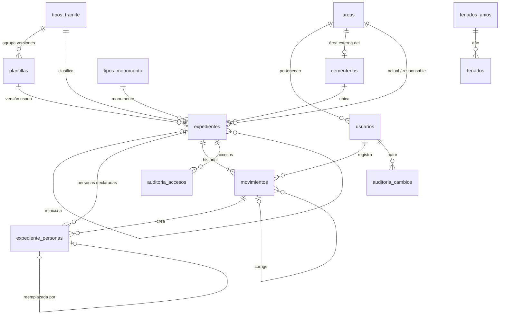

# CementerIA: propuesta final del MVP de seguimiento de expedientes de la Dirección de Cementerios

> **Estado:** borrador para confirmar, 19/10/2026. Dirección de Inteligencia Artificial (SMT).
>
> **Actualizado el 27/10/2026: el ingreso pasa a usuario y contraseña propios; Cidituc en pausa.** Se entra con CUIL (o correo) y contraseña (scrypt, bloqueo por intentos, contraseña temporal en el alta y en los blanqueos, cambio obligatorio). La sesión, la autorización y los permisos no cambian. El código de Cidituc sigue, apagado con `CIDITUC_HABILITADO=0`, listo para reactivarse. Donde este documento dice que el login es Cidituc, vale esta nota. Detalle: docs/api-dominio.md, sección 22.
> Se escribió sin el PDF de procedimientos y con el pedido cortado en "traslado de restos,". Lo que es inferencia lleva la marca [I] y lo que hay que confirmar con la Dirección de Cementerios, la marca [C].

## Resumen ejecutivo

- **Qué es:** una aplicación web interna que reemplaza la ficha de papel. El expediente de papel sigue siendo el oficial. La herramienta no se conecta con Cómputo, con el sistema municipal ni con la DIM: convive con ellos.
- **Modelo compacto:** 11 tablas de dominio y 2 de auditoría. Cada tipo de trámite se define en una plantilla versionada. La definición se guarda en JSONB, se valida con zod y queda congelada al publicarse. Agregar un trámite nuevo no requiere código ni migraciones.
- **Historial:** `movimientos` admite solo inserciones. Lo garantizan los privilegios y los triggers de la base, declarados `ENABLE ALWAYS`. Un trigger fija el autor y la fecha de registro. Los errores se corrigen agregando asientos, nunca borrando. La cadena de hash y la conciliación nocturna pasan a la fase 2. La garantía, dicha sin exagerar: la aplicación no puede alterar el historial. Un superusuario de PostgreSQL sí puede, y lo que lo vuelve detectable es la configuración de logs que pidamos a Sistemas. *Actualizado el 26/10/2026: la cadena de hash dejó de ser fase 2. Cada movimiento lleva el hash del anterior del mismo expediente (`f_hash_movimiento`, migración `*_cadena_hash`); la ficha la verifica ("Verificar integridad"), la carátula y el historial impresos llevan su huella, y un timer la verifica todas las noches. El export firmado de las cabezas y la conciliación nocturna siguen en la fase 2 (sección 8).*
- **Fechas:** cada movimiento tiene fecha efectiva y fecha de registro, con precisión y fuente. Así se cargan expedientes de años anteriores y pases demorados sin falsear la auditoría.
- **Flujo:** el pase va siempre al paso siguiente de la plantilla. La devolución exige motivo, destilda lo que hay que rehacer y después permite reenviar directo al área que devolvió. La recepción se confirma con un clic y no bloquea. La DIM y los cementerios son áreas externas sin usuarios, y las opera un área de custodia definida en cada paso.
- **Datos personales:** el contacto completo y los adjuntos los ve quien trabaja el expediente. El resto los ve enmascarados y puede abrirlos dando un motivo, que queda registrado. Las personas se guardan versionadas, así que los datos de un tercero cargados por error se pueden suprimir.
- **Stack:** Next.js 16.4.2 creado con `create-next-app`, React 19, Prisma 7.9 con `@prisma/adapter-pg` (la configuración de DiarioDigital), PostgreSQL 15. SubastaCementerio no sirve de scaffold porque usa Supabase y no Prisma. El login es Cidituc con el endpoint de empleados. *Actualizado el 27/10/2026: el ingreso pasa a usuario y contraseña propios; Cidituc en pausa.* Se despliega en servidores municipales, como DIM360.
- **Plan:** con 2 desarrolladores son 8 semanas: 5 de construcción, 2 de piloto y 1 de corte. Con 1 desarrollador son 11. El corte de la ficha es por tipo de trámite, a medida que se publica cada plantilla.
- **Antes de codificar necesito tu confirmación** sobre los puntos del final de la sección 8.

## 1. Supuestos y decisiones clave

1. **El papel sigue siendo el expediente oficial y la herramienta reemplaza solo la ficha.** Lo que Cómputo, Liquidación o la DIM hacen en sus sistemas queda registrado como subtarea tildada, con un dato opcional (por ejemplo, el N° de registro en Cómputo). *Por qué:* es el alcance del MVP y evita la integración, que es la dependencia más riesgosa.
2. **Modelo compacto: lo que varía por trámite va en JSONB validado y congelado; las personas van en una tabla propia, versionada, como copia de lo declarado en cada expediente.** Pasos, checklist, conceptos, campos extra y roles de persona viven en `plantillas.definicion`. Titular, solicitante, difuntos y cesionarios son filas de `expediente_personas`. Editar una persona crea una fila nueva y marca la anterior como no vigente. No hay un padrón global de personas. *Por qué:* normalizar las plantillas son 7 a 9 tablas que no entran en un MVP de 1 o 2 desarrolladores, y el JSONB congelado y validado al publicar da la misma garantía práctica. Las personas sí piden tabla, porque hay varios cesionarios y titulares fallecidos y la Ley 25.326 desaconseja un padrón cruzado. Al versionarlas, el historial se reconstruye sin copiar datos personales en `movimientos`, y la supresión es posible.
3. **El tipo de trámite no es lo mismo que la plantilla.** `tipos_tramite` es la categoría de negocio (Renovación, Renovación SPT, Nueva concesión). La plantilla combina el tipo con la forma de pago. *Por qué:* el alta pide "tipo de trámite", y así (a) y (b) suman juntas en las estadísticas.
4. **Cada versión de plantilla es una fila que queda congelada al publicarse, y el expediente apunta a su versión. En el MVP no hay "cambiar plantilla".** Los expedientes en curso terminan con la versión con la que empezaron. Si el concesionario pasa de contado a plan de pagos a mitad del trámite, se usa "Reiniciar con otra plantilla": se anula el expediente con motivo y se abre un alta precargada, vinculada por `expediente_anterior_id`. *Por qué:* mapear por clave entre plantillas conserva subtareas que tienen la misma clave y otro significado (por ejemplo LIQ_BOLETA, con o sin arrendamiento) y puede saltear pasos obligatorios. Hacerlo bien cuesta más que el caso, que es infrecuente (pregunta 4).
5. **El historial es inalterable a nivel base y la lógica de negocio queda en TypeScript.** Hay privilegios mínimos, triggers contra UPDATE, DELETE y TRUNCATE, y un trigger de inserción que fija `registrado_en` y verifica el autor, todos con `ENABLE ALWAYS`. La app escribe la proyección en la misma transacción. *Por qué:* es lo que pide "inalterable". La cadena de hash, el digest externo y la conciliación por replay cuestan dos semanas de un plan ajustado, y bien hechos exigen una función SQL única y un export firmado. Pasan a la fase 2 (pregunta 3). Actualizado el 26/10/2026: la cadena de hash ya está, con la función SQL única que usan el trigger y el verificador (2.11, 2.13(b)); el digest externo firmado y la conciliación por replay siguen en la fase 2.
6. **Cada movimiento tiene `fecha_efectiva`, `registrado_en`, `precision_fecha` y `fuente`.** La regla "la fecha no retrocede" se aplica solo entre movimientos que cambian la ubicación del papel (alta, recepción, pase, devolución y estado), y a nivel de día cuando alguno tiene precisión de día. *Por qué:* el sistema municipal no admite fechas pasadas, y las subtareas, notas y documentos se registran muchas veces después del hecho. Si entraran en la comparación, bloquearían los pases demorados.
7. **El pase es lineal, sin desvíos ni pases forzados.** El destino es el paso siguiente, el paso que devolvió (reenvío directo) o un paso posterior salteando solo pasos `omitible`, con motivo. *Por qué:* el pedido dice que el expediente "avanza al paso siguiente de su plantilla", y los desvíos reintroducen el error de mandar el papel a cualquier lado.
8. **La recepción se confirma, pero no bloquea.** El pase deja el expediente "sin confirmar" en el área de destino. Esa área confirma con un clic, de a uno o en lote, y cualquier acción suya lo confirma sola. El panel alerta los envíos sin confirmar con más de 2 días hábiles. *Por qué:* detecta un expediente perdido entre dos áreas sin sumar un clic obligatorio por pase.
9. **La DIM y los tres cementerios son áreas `externa` sin usuarios, y cada paso externo declara su `custodia`.** El área de custodia registra lo que pasa afuera y la vuelta del papel. *Por qué:* no figuran como roles, y sin custodia explícita Liquidación terminaría respondiendo por lo que informa el cementerio.
10. **Cada usuario tiene un área y un rol: `operador`, `lectura` o `admin`.** Las acciones excepcionales (anular, reabrir, desarchivar, archivar sin concluir, reiniciar con otra plantilla, carga histórica) las hacen Mesa de Entradas y el admin. Cidituc solo da la identidad; la autorización se resuelve contra `usuarios` en cada request. *Por qué:* son los roles del pedido. Un rol "jefe" sumaría un concepto que la Dirección todavía no pidió (pregunta 9).
11. **La herramienta no calcula ni decide.** Los conceptos a cobrar no llevan importes. El plazo de 30 días hábiles de la DIM genera alertas pero no cambia el estado. *Por qué:* los montos salen de Liquidación, y lo que pasa al vencer el plazo es otro trámite y una decisión humana.
12. **Despliegue on-prem: Ubuntu, nginx, systemd y el PostgreSQL 15 de Sistemas. Los adjuntos van al disco del servidor.** *Por qué:* hay DNI y actas alcanzados por la Ley 25.326, y es la operación de DIM360.
13. **Minimización de datos personales.** Teléfono, correo, domicilio y adjuntos se ven completos solo para el área responsable actual, las áreas por las que pasó el expediente, Mesa de Entradas, Dirección y el admin. El resto ve la ficha con el contacto enmascarado y un botón "Ver datos completos" que pide motivo y queda en `auditoria.accesos`. *Por qué:* lo piden los arts. 4 y 9 de la Ley 25.326, y el registro de accesos solo detecta, no minimiza (pregunta 7).

## 2. Modelo de datos

**Extensiones:** `unaccent` y `pg_trgm`. `pgcrypto` deja de ser necesaria, porque los UUID salen de `gen_random_uuid()`, que en PostgreSQL 15 es nativa.

**Esquemas:** `public` (dominio) y `auditoria`.

**Roles de base:**
- `cementeria_owner` (NOLOGIN): dueño de todos los objetos.
- `cementeria_deploy` (LOGIN, NOINHERIT, miembro de `cementeria_owner`) con `ALTER ROLE cementeria_deploy SET role = 'cementeria_owner'`. Así, todo lo que crea `prisma migrate deploy`, incluida `_prisma_migrations`, queda a nombre del owner. Su credencial no queda en el servidor.
- `cementeria_app` (LOGIN): el rol con el que corre la aplicación.
- Un test de integración verifica que `SELECT tableowner FROM pg_tables WHERE schemaname IN ('public','auditoria')` devuelva `cementeria_owner` para todas las tablas.

**Convenciones:**
- Nombres en snake_case, mapeados en Prisma con `@@map`.
- Fechas con hora en `timestamptz`. `ALTER DATABASE cementeria SET timezone = 'America/Argentina/Tucuman'`.
- Las columnas `date` se tratan en el dominio como texto `YYYY-MM-DD` (ver 6, Fechas).
- Las columnas derivadas las mantienen triggers o la app, no `GENERATED`.
- Los índices parciales, los GIN trigram, los triggers y los GRANTs van en SQL escrito a mano. CI corre `prisma migrate diff --from-migrations prisma/migrations --to-schema prisma/schema.prisma --exit-code` y un test compara `pg_indexes` contra la lista de índices esperados, para que ninguna migración generada los borre sin que se note.
- Toda escritura pasa por `conActor(usuarioId, motivo, fn)` (`lib/db/transaccion.ts`), que abre un `$transaction` interactivo y fija `app.usuario_id` y `app.motivo` con `set_config(..., true)`. En SQL se lee siempre con `nullif(current_setting('app.usuario_id', true), '')::int`. Una regla de lint prohíbe `prisma.<modelo>.create/update` fuera de ese helper.

En las tablas, NN significa NOT NULL y N acepta nulos.

### 2.1 `areas`

| Columna | Tipo | Null | Default | Notas |
|---|---|---|---|---|
| id | smallint identity | NN | | PK |
| codigo | text | NN | | UNIQUE |
| nombre | text | NN | | |
| tipo | text | NN | 'interna' | CHECK in ('interna','externa') |
| recibe_pases | boolean | NN | true | CHECK (tipo = 'interna' OR recibe_pases) |
| activa | boolean | NN | true | |
| orden | smallint | NN | 0 | |

**Semilla:**
- Internas: `MESA_ENTRADAS`, `COMPUTO`, `LIQUIDACION`, `LEGAL`, `ADMINISTRATIVO` y `TRIBUTARIO` ("Departamento Tributario / Notificación"). `DIRECCION` es interna con `recibe_pases = false`.
- Externas: `DIM`, `CEM_OESTE`, `CEM_NORTE` y `CEM_JARDIN_NORTE`.

### 2.2 `cementerios`

| Columna | Tipo | Null | Default | Notas |
|---|---|---|---|---|
| id | smallint identity | NN | | PK |
| codigo | text | NN | | UNIQUE: `OESTE`, `NORTE`, `JARDIN_NORTE` |
| nombre | text | NN | | |
| area_id | smallint | NN | | FK areas, UNIQUE (su área externa) |
| campos_ubicacion | jsonb | NN | '[]' | CHECK jsonb_typeof = 'array'. Cada campo: `{clave, etiqueta, tipo: texto\|entero, obligatorio, patron, activo, ayuda?}` (`ayuda`, opcional: cómo se escribe, para el formulario y el error) |
| tipos_monumento | text[] | NN | '{}' | Códigos habilitados en ese cementerio (los valida la app) |
| activo | boolean | NN | true | |

> Actualizado el 20/10/2026 según docs/fuentes: **nomenclatura y monumentos de la semilla.**
> - Oeste: Sección (texto, patrón `[A-H]`, una letra de la A a la H, según el plano base), Lote y N°. Sin cuadro: el plano no tiene cuadros.
> - Jardín Norte: Sección en números romanos (texto, patrón `XL|X{0,3}(?:IX|IV|V?I{0,3})`, de I a XL [C: el tope]), Lote y N°.
> - Norte: la provisoria (Sección · Cuadro · Lote · N°).
> - Lote y N° siguen provisorios en los tres: falta saber cómo se numera dentro de cada sección [C].
> - Tipos de monumento: Oeste y Norte habilitan SEPULTURA ("Sepultura o bóveda"), SOTANITO, CAPILLA, MAUSOLEO y PANTEON; Jardín Norte, solo SEPULTURA.
> - Como los valores se guardan en mayúsculas, "iv" e "IV" (o "b" y "B") dan la misma `ubicacion_clave`.

El alta exige que el cementerio tenga al menos un tipo de monumento habilitado, y al menos un campo de ubicación activo si la plantilla dice `ubicacion_obligatoria: true`. Si no los tiene, el formulario muestra "Falta configurar el cementerio" en lugar de una lista vacía.

### 2.3 `tipos_monumento` y `tipos_tramite`

| Tabla | Columnas |
|---|---|
| `tipos_monumento` | id smallint identity PK; codigo text NN UNIQUE CHECK ~ '^[A-Z_]+$'; nombre text NN; activo boolean NN true. Semilla: `SOTANITO`, `CAPILLA`, `MAUSOLEO`, `SEPULTURA` ("Sepultura o bóveda"), `PANTEON`, más `NICHO` y `CINERARIO_COMUN` [I] (Actualizado el 20/10/2026 según docs/fuentes: se agregó el panteón y SEPULTURA se llama "Sepultura o bóveda", como en los procedimientos; NICHO y CINERARIO_COMUN quedan en el catálogo pero ningún cementerio los habilita) |
| `tipos_tramite` | id smallint identity PK; codigo text NN UNIQUE; nombre text NN; activo boolean NN true. Semilla: `RENOVACION`, `RENOVACION_SPT`, `NUEVA_CONCESION`. Los demás se agregan desde `/admin/catalogos` |

### 2.4 `usuarios`

| Columna | Tipo | Null | Default | Notas |
|---|---|---|---|---|
| id | integer identity | NN | | PK |
| cuil | char(11) | NN | | UNIQUE; CHECK ~ '^[0-9]{11}$' |
| cidituc_id | text | N | | UNIQUE; `id_persona` como texto, se vincula en el primer ingreso |
| nombre, apellido | text | NN | | Se actualizan desde Cidituc |
| email | text | N | | |
| area_id | smallint | N | | FK areas. CHECK (rol = 'admin' OR area_id IS NOT NULL) |
| rol | text | NN | 'operador' | CHECK in ('operador','lectura','admin') |
| activo | boolean | NN | true | |
| sesion_version | integer | NN | 0 | Al incrementarse, invalida todas las sesiones del usuario |
| ultimo_ingreso | timestamptz | N | | |
| creado_en, actualizado_en | timestamptz | NN | now() | |

- **Usuario técnico `SISTEMA`:** id 1, `cuil = '00000000000'`, rol `admin`, sin área, `activo = false`. Lo inserta la migración inicial antes de crear los triggers de auditoría. La semilla y los scripts escriben como `SISTEMA`, y nadie puede ingresar con él.
- El trigger `usuarios_area_interna` rechaza un área externa.
- Dirección se modela como `area = DIRECCION` con `rol = lectura`.
- No hay DELETE: la baja es `activo = false`.

### 2.5 `plantillas` (una fila por versión)

| Columna | Tipo | Null | Default | Notas |
|---|---|---|---|---|
| id | integer identity | NN | | PK |
| codigo | text | NN | | CHECK ~ '^[A-Z0-9_]+$' |
| version | smallint | NN | | UNIQUE (codigo, version) |
| tipo_tramite_id | smallint | NN | | FK tipos_tramite; el trigger exige el mismo tipo en todas las versiones de un código |
| nombre | text | NN | | |
| estado | text | NN | 'borrador' | CHECK in ('borrador','publicada','retirada') |
| definicion | jsonb | NN | | Esquema zod `DefinicionPlantilla` |
| notas_cambio | text | N | | |
| creado_por / publicado_por | integer | NN / N | | FK usuarios |
| creado_en / publicado_en | timestamptz | NN / N | now() / — | CHECK (estado = 'borrador' OR (publicado_en IS NOT NULL AND notas_cambio IS NOT NULL)) |

**Índices únicos parciales:** `(codigo) WHERE estado = 'publicada'` y `(codigo) WHERE estado = 'borrador'`.

**Trigger `plantillas_congelar` (ENABLE ALWAYS):** fuera de borrador rechaza cualquier cambio de `definicion`, `nombre`, `codigo`, `version` o `tipo_tramite_id`. Solo permite las transiciones borrador→publicada y publicada→retirada, y solo deja borrar borradores.

Forma de `definicion` (cada clave es única dentro de toda la definición):

```json
{
  "forma_pago": "contado",
  "tipos_monumento": ["SOTANITO","CAPILLA","MAUSOLEO","SEPULTURA"],
  "ubicacion_obligatoria": true,
  "requiere_contacto": true,
  "personas": [
    {"rol":"titular","etiqueta":"Titular de la concesión","min":1,"max":1,"fallecido":"no","pide_vinculo":false},
    {"rol":"solicitante","etiqueta":"Solicitante","min":0,"max":1,"fallecido":"no","pide_vinculo":true}
  ],
  "campos_extra": [
    {"clave":"concesion_hasta","etiqueta":"Vencimiento de la concesión","tipo":"fecha",
     "obligatorio":false,"exigir_al_salir_de":"COMPUTO_FINAL","buscable":false,"opciones":null}
  ],
  "documentos": [
    {"clave":"DNI","nombre":"Fotocopia del DNI","origen":"concesionario","obligatorio":true,
     "exigir_al_salir_de":"MESA","adjunto":"no"}
  ],
  "conceptos": [{"clave":"DERECHO_OFICINA","nombre":"Derecho de oficina","via":"boleta","paso":"LIQUIDACION"}],
  "pasos": [
    {"clave":"LIQUIDACION","nombre":"Liquidación y boleta","area":"LIQUIDACION","custodia":null,
     "estado":"en_tramite","omitible":false,"dias_alerta":15,"instrucciones":"Liquida, genera débitos…","plazo":null,
     "subtareas":[{"clave":"LIQ_PAGO","nombre":"Pago verificado","obligatoria":true,"dato":"fecha","dato_obligatorio":true}]}
  ]
}
```

Valores admitidos por campo:

| Campo | Valores |
|---|---|
| `forma_pago` | `contado`, `plan_pagos`, `a_elegir` (se elige en el alta) o `no_aplica` |
| `tipos_monumento` | Códigos de `tipos_monumento`; `[]` = todos los habilitados en el cementerio |
| `requiere_contacto` | `true` (por defecto) exige una persona marcada como contacto; `false` para trámites de oficio |
| `personas[].rol` | ~ '^[a-z_]+$'. Los roles nuevos, como `cesionario` o `difunto`, se definen acá sin código |
| `personas[].fallecido` | `no`, `si` u `opcional` |
| `campos_extra[].tipo` | `texto`, `numero`, `fecha`, `opcion` (exige `opciones: string[]`) o `cementerio` |
| `campos_extra[].buscable` | Si es `true`, el valor entra en la búsqueda |
| `documentos[].origen` | `direccion` o `concesionario` |
| `documentos[].exigir_al_salir_de` | Clave de un paso, o `null` (se exige al concluir) |
| `documentos[].adjunto` | `no`, `sugerido` u `obligatorio` |
| `conceptos[].via` | `boleta` o `plan_dim` |
| `pasos[].area` | Código de área, `"$CEMENTERIO"` (cementerio del expediente) o `"$CAMPO:<clave>"` (campo extra de tipo `cementerio`) |
| `pasos[].custodia` | Código de área interna. Es obligatorio si el área es externa o un comodín, y nulo si no |
| `pasos[].estado` | `en_tramite` o `espera_pago_dim` |
| `pasos[].dias_alerta` | Entero, obligatorio; días hábiles en el área a partir de los cuales la bandeja lo marca demorado |
| `pasos[].instrucciones` | Texto opcional que se muestra en la ficha |
| `subtareas[].dato` | `null`, `fecha` o `texto` |
| `pasos[].plazo` | `{"dias_habiles":30,"desde_subtarea":"TRIB_NOTIFICADA","hasta_subtarea":"DIM_PLAN_INICIADO"}` |
| `personas[].admite_juridica` | Actualizado el 20/10/2026 según docs/fuentes. `true`: el rol puede ser una persona jurídica (razón social y CUIT). Por defecto `false` |
| `conceptos[]`, `documentos[]`, `subtareas[]`: `solo_cementerios` / `excepto_cementerios` | Actualizado el 20/10/2026 según docs/fuentes. Códigos de `cementerios`, o `null` (por defecto: en todos). Uno u otro. Lo que no corresponde al cementerio del expediente no aparece ni se exige |
| `documentos[].solo_si_juridica` | Actualizado el 20/10/2026 según docs/fuentes. Rol de persona (con `admite_juridica`), o `null`. El documento corresponde solo si alguna persona vigente de ese rol es jurídica |

> Actualizado el 20/10/2026 según docs/fuentes: la definición de un expediente es la de su plantilla **resuelta** para su cementerio y sus personas (`src/lib/dominio/plantillas/resolver.ts`): la ficha, la carátula, el "Faltan N", el pase, la devolución y la bandeja usan la misma. "Publicar" valida además que los cementerios de los filtros existan y estén activos, que no vayan los dos filtros juntos, que las subtareas de un plazo no se filtren y que `solo_si_juridica` nombre un rol que admite persona jurídica.

### 2.6 `expedientes` (estado actual, la proyección)

> Actualizado 28/10/2026: columna nueva **`codigo_consulta`** (text NN UNIQUE, CHECK `^[0-9A-HJKMNP-TV-Z]{8}$`): el código de la consulta pública que va en el comprobante del concesionario. Lo genera el alta; los expedientes anteriores lo recibieron en la migración `*_consulta_publica`. Cambia solo con "Regenerar código de consulta" (trigger `expedientes_codigo_consulta`). Ver docs/api-dominio.md, sección 24.

| Columna | Tipo | Null | Default | Notas |
|---|---|---|---|---|
| id | bigint identity | NN | | PK |
| anio, secuencia | smallint, integer | NN | | UNIQUE (anio, secuencia) |
| numero_interno | text | NN | | UNIQUE, `CEM-2026-00042` |
| numero_municipal | text | N | | Tal como se escribe |
| numero_municipal_norm | text | N | | Trigger: mayúsculas, solo alfanuméricos. Índice btree no único (pregunta 5) |
| fecha_inicio | date | NN | | CHECK >= '1950-01-01'; el trigger exige <= hoy (Tucumán) |
| tipo_tramite_id | smallint | NN | | FK tipos_tramite (copiado de la plantilla) |
| plantilla_id | integer | NN | | FK plantillas (versión exacta) |
| expediente_anterior_id | bigint | N | | FK expedientes. Lo completa "Reiniciar con otra plantilla" |
| cementerio_id | smallint | NN | | FK cementerios |
| tipo_monumento | text | NN | | FK tipos_monumento(codigo) |
| ubicacion | jsonb | NN | '{}' | CHECK object; GIN `jsonb_path_ops` |
| ubicacion_clave | text | N | | Trigger, solo cuando cambia `ubicacion`: pares `clave=valor` no vacíos, ordenados alfabéticamente por clave. NULL si no hay valores. Índice (cementerio_id, ubicacion_clave) WHERE ubicacion_clave IS NOT NULL |
| ubicacion_texto | text | NN | '' | "Secc. 3 · Cuadro B · Lote 12 · N° 45" (app) |
| padron, padron_norm | text | N | | `padron_norm` por trigger; índice btree |
| forma_pago | text | N | | CHECK in ('contado','plan_pagos'); nulo solo si la plantilla dice `no_aplica` |
| observaciones | text | N | | |
| datos_extra | jsonb | NN | '{}' | Valores de `campos_extra` |
| estado | text | NN | 'en_tramite' | CHECK in ('en_tramite','espera_pago_dim','concluido','archivado','anulado') |
| estado_previo | text | N | | CHECK ((estado IN ('archivado','anulado')) = (estado_previo IS NOT NULL)) |
| ubicacion_archivo | text | N | | Caja o estante; CHECK (estado <> 'archivado' OR ubicacion_archivo IS NOT NULL). En carga histórica se admite `DESCONOCIDA` |
| paso_clave, paso_orden | text, smallint | NN | | Paso actual |
| paso_retorno_clave | text | N | | Paso que devolvió; habilita el reenvío directo |
| area_actual_id | smallint | NN | | FK areas: dónde está el papel |
| area_responsable_id | smallint | NN | | FK areas: quién lo opera (el área del paso, o su custodia) |
| en_area_desde | timestamptz | NN | | Fecha efectiva del último movimiento de ubicación |
| recibido_en | timestamptz | N | | NULL = recepción sin confirmar |
| plazo_desde, plazo_dias_habiles, plazo_cumplido_en | date, smallint, date | N | | Solo con valor mientras el expediente está en el paso del plazo. CHECK (plazo_desde IS NULL OR plazo_dias_habiles IS NOT NULL) |
| items | jsonb | NN | '{}' | Estado de subtareas, documentos y adjuntos, por clave (ver abajo) |
| carga_historica | boolean | NN | false | |
| busqueda | text | NN | '' | La arma la app (`lib/dominio/busqueda.ts`) en la misma transacción de cada cambio; GIN `gin_trgm_ops` |
| creado_por | integer | NN | | FK usuarios |
| creado_en, actualizado_en | timestamptz | NN | now() | |
| version | integer | NN | 0 | Bloqueo optimista: toda acción que inserta un movimiento la incrementa y exige la versión que vio el usuario |

Forma de `items`:

```json
{"subtareas":{"LIQ_PAGO":{"hecha":true,"dato":"2026-10-15","mov":815,"reiniciada_por_mov":null,"historica":false}},
 "documentos":{"COMPROBANTE_PAGO":{"estado":"presentado","obs":null,"mov":812,"adjuntos":[830]}},
 "adjuntos":{"830":{"documento":"COMPROBANTE_PAGO","vigente":true}}}
```

El estado de un documento es `pendiente`, `presentado`, `no_corresponde` o `historico` (documentación de pasos cumplidos antes del sistema, que nadie verificó en la herramienta).

**Índices:**
- `(area_responsable_id, estado)` para las bandejas.
- `(area_actual_id) WHERE recibido_en IS NULL` para la pestaña "Por confirmar".
- `(estado, en_area_desde)` para el panel.
- `(tipo_tramite_id, fecha_inicio)` para los listados por tipo.
- `(plazo_desde) WHERE plazo_desde IS NOT NULL` para la pestaña Plazos.

### 2.7 `expediente_personas` (copia versionada de lo declarado en cada trámite)

| Columna | Tipo | Null | Default | Notas |
|---|---|---|---|---|
| id | bigint identity | NN | | PK |
| expediente_id | bigint | NN | | FK expedientes ON DELETE RESTRICT |
| rol | text | NN | | CHECK ~ '^[a-z_]+$'; debe existir en `definicion.personas` (lo valida la app) |
| orden | smallint | NN | 1 | UNIQUE (expediente_id, rol, orden) WHERE vigente |
| tipo_persona | text | NN | 'fisica' | CHECK in ('fisica','juridica'). Actualizado el 20/10/2026 según docs/fuentes (asociaciones con panteón) |
| apellido, nombres | text | N | | NN en una física salvo suprimida; NULL en una jurídica (CHECK de nombre y de datos por tipo) |
| dni | text | N | | Solo dígitos; CHECK ~ '^[0-9]{6,9}$'; índice btree. NULL en una jurídica |
| razon_social | text | N | | Actualizado el 20/10/2026 según docs/fuentes. NN en una jurídica no suprimida; NULL en una física |
| cuit | text | N | | Actualizado el 20/10/2026 según docs/fuentes. NN en una jurídica no suprimida; CHECK `f_cuit_valido` (11 dígitos y dígito verificador); NULL en una física; índice btree. La app exige además prefijo de persona jurídica (30, 33 o 34) |
| fallecido | boolean | NN | false | Una jurídica, siempre false |
| fecha_defuncion | date | N | | CHECK (fecha_defuncion IS NULL OR fallecido) |
| vinculo | text | N | | "hijo", "cónyuge", "apoderado" |
| telefono | text | N | | |
| telefono_whatsapp | boolean | NN | false | |
| email, domicilio | text | N | | |
| es_contacto | boolean | NN | false | UNIQUE parcial (expediente_id) WHERE es_contacto AND vigente |
| vigente | boolean | NN | true | |
| reemplazada_por_id | bigint | N | | FK expediente_personas: la versión que la reemplazó |
| creada_mov_id | bigint | NN | | FK movimientos (`alta` o `edicion` que la creó) |
| suprimida_en | timestamptz | N | | Supresión por Ley 25.326 (ver 2.13(b)) |
| nombre_norm | text | NN | '' | Trigger: `f_normalizar(apellido ‖ ' ' ‖ nombres ‖ ' ' ‖ razon_social)`; GIN trigram |

- Editar una persona inserta una fila nueva y pasa la anterior a `vigente = false` con `reemplazada_por_id`. Quitar una persona es pasarla a `vigente = false`.
- **Trigger `expediente_personas_proteger` (ENABLE ALWAYS):** admite solo dos clases de UPDATE. La primera pasa `vigente` de true a false y fija `reemplazada_por_id`. La segunda es la supresión: pone en NULL apellido, nombres, dni, razón social y CUIT (Actualizado el 20/10/2026 según docs/fuentes: la Ley 25.326 también protege a las personas de existencia ideal), teléfono, email, domicilio y vínculo, fija `suprimida_en` y exige `app.motivo`; `tipo_persona` se conserva. Cualquier otro UPDATE se rechaza. No hay DELETE.
- Como `creada_mov_id` es NN y el movimiento se inserta antes, el `alta` y la `edicion` se insertan primero y las personas después, en la misma transacción.

### 2.8 `movimientos` (historial, solo inserción)

| Columna | Tipo | Null | Default | Notas |
|---|---|---|---|---|
| id | bigint identity | NN | | PK |
| expediente_id | bigint | NN | | FK expedientes ON DELETE RESTRICT |
| secuencia | integer | NN | | La asigna el trigger; UNIQUE (expediente_id, secuencia) |
| tipo | text | NN | | CHECK in ('alta','recepcion','pase','devolucion','subtarea','documento','adjunto','edicion','estado','nota','correccion') |
| fecha_efectiva | timestamptz | NN | | Con `precision_fecha = 'dia'` se guarda a las 00:00 de Tucumán |
| precision_fecha | text | NN | 'minuto' | CHECK in ('dia','minuto') |
| registrado_en | timestamptz | NN | now() | El trigger siempre lo pisa con now() |
| usuario_id | integer | NN | | FK usuarios; el trigger exige que sea igual a `app.usuario_id` |
| area_usuario_id | smallint | N | | Lo completa el trigger desde `usuarios` |
| paso_origen, paso_destino | text | N | | |
| area_origen_id, area_destino_id | smallint | N | | FK areas (siempre el área concreta, nunca un comodín) |
| estado_anterior, estado_nuevo | text | N | | |
| observacion, motivo | text | N | | |
| datos | jsonb | NN | '{}' | Sin datos personales de las personas: solo ids de `expediente_personas` |
| corrige_movimiento_id | bigint | N | | FK movimientos |
| carga_historica | boolean | NN | false | |
| fuente | text | N | | "Ficha papel", "Libro de pases de Legal" |
| comando_id | uuid | NN | | Idempotencia: UNIQUE (expediente_id, comando_id, tipo). Un comando por acción del usuario y uno por fila de la transcripción |
| hash_anterior | text | NN (CHECK) | | Actualizado el 26/10/2026 (cadena de hash). El `hash` del movimiento anterior del expediente, por secuencia; en el primero, `f_hash_inicial(numero_interno)`. Lo fija el trigger |
| hash | text | NN (CHECK) | | Actualizado el 26/10/2026. `f_hash_movimiento(fila)`: SHA-256 en hex de una lista explícita de campos, `hash_anterior` incluido (2.11). Lo fija el trigger. Nulables para Prisma; el CHECK `movimientos_hash_check` los exige y pide hex de 64 |

**CHECKs:**
- `tipo IN ('pase','devolucion')` ⇒ `paso_destino` y `area_destino_id` NOT NULL.
- `(tipo = 'correccion') = (corrige_movimiento_id IS NOT NULL)`.
- `tipo = 'estado'` ⇒ `estado_nuevo` NOT NULL.
- Motivo de al menos 10 caracteres (`length(btrim(motivo)) >= 10`) cuando se cumple cualquiera de estas condiciones:
  - el tipo es `devolucion` o `correccion`;
  - `tipo = 'estado' AND estado_nuevo = 'anulado'`;
  - se archiva sin concluir (`estado_nuevo = 'archivado' AND estado_anterior <> 'concluido'`);
  - se desarchiva o se reabre (`estado_anterior IN ('archivado','anulado')`);
  - se destilda una subtarea (`tipo = 'subtarea' AND datos->>'hecha' = 'false'`);
  - un pase saltea pasos omitibles (`tipo = 'pase' AND jsonb_array_length(coalesce(datos->'pasos_omitidos','[]')) > 0`).
- `fecha_efectiva <= registrado_en + interval '5 minutes'`.
- `NOT carga_historica OR fuente IS NOT NULL`.

**Índices:** `(usuario_id, registrado_en)`, `(area_destino_id, fecha_efectiva) WHERE tipo IN ('pase','devolucion')`, `(expediente_id, area_destino_id)` (para "pasó por el área") y `(tipo, registrado_en)`.

**Contenido de `datos` según el tipo:**

| Tipo | `datos` |
|---|---|
| `alta` | Datos del expediente, sin personas. Las personas que crea se obtienen por `expediente_personas.creada_mov_id`: el movimiento se inserta antes que ellas y no se puede actualizar después |
| `recepcion` | `{implicita: bool}` |
| `pase` | `{pasos_omitidos:[…], pasos_salteados:[…]}`: los omitidos exigen motivo; los salteados corresponden al reenvío directo |
| `devolucion` | `{subtareas_reiniciadas:[…]}` |
| `subtarea` | `{subtarea, hecha, dato}` |
| `documento` | `{documento, estado}` |
| `adjunto` | `{nombre, mime, bytes, sha256, documento, ruta}` |
| `edicion` | `{cambios:{campo:[antes,después]}, personas:{baja:[ids], reemplazadas:[ids]}}`. Solo lleva ids que ya existen. Las altas y las nuevas versiones se obtienen por `creada_mov_id` y `reemplazada_por_id`. Los campos de persona nunca van en `cambios` |
| `estado` | `{ubicacion_archivo}` o `{regreso_papel:{fecha, area_id}}` |
| `nota` | `{}` |
| `correccion` | `{revertir:true}`, `{fecha_efectiva:[a,b]}`, `{observacion:[a,b]}`, `{retirar_adjunto:830, purgar:bool}`, `{subtarea:CLAVE, dato:[a,b]}`, `{subtarea:CLAVE, hecha:false}` o `{suprimir_persona:id}` |

### 2.9 `feriados` y `feriados_anios`

| Tabla | Columnas |
|---|---|
| `feriados` | fecha date PK; descripcion text NN; ambito text NN 'nacional' CHECK in ('nacional','provincial','municipal','asueto','feria'); norma text N |
| `feriados_anios` | anio smallint PK; cerrado boolean NN false; cerrado_por integer N FK usuarios; cerrado_en timestamptz N. El admin "cierra" un año cuando cargó todos sus feriados. Un vencimiento que cae en un año sin cerrar se muestra como provisorio |

### 2.10 Esquema `auditoria` (solo inserción)

| Tabla | Columnas |
|---|---|
| `auditoria.cambios` | id bigint identity PK; tabla text NN; registro_id text NN; operacion char(1) CHECK in ('I','U','D'); antes, despues jsonb N; usuario_id integer NN (de `app.usuario_id`); motivo text N (de `app.motivo`); txid bigint NN `txid_current()`; en timestamptz NN `clock_timestamp()`; índice (tabla, registro_id). Solo configuración: no guarda datos de expedientes ni de personas |
| `auditoria.accesos` | id bigint identity PK; usuario_id integer N; accion text CHECK in ('ingreso','ingreso_rechazado','salida','ver_expediente','ver_datos_completos','ver_adjunto','descargar_adjunto','imprimir','exportar', y, actualizado el 26/10/2026, 'verificar_historial'; el 27/10/2026, 'bloqueo', 'desbloqueo', 'cambio_clave', 'blanqueo_clave'; actualizado 28/10/2026, 'consulta_publica' (sin usuario) y 'regenerar_codigo_consulta' (con el motivo en el detalle)); expediente_id bigint N; detalle jsonb NN '{}' (incluye el motivo de `ver_datos_completos`); ip inet N; en timestamptz NN now(); índices (expediente_id, en) y (usuario_id, en) |

> Actualizado 28/10/2026: **`auditoria.intentos_consulta`** (id bigint identity PK; en timestamptz NN; ip inet N; numero text N, el canónico; resultado text CHECK in ('fallido','bloqueado'); índices (ip, en) y (numero, en)): los intentos fallidos de la consulta pública, para el límite por IP y por número. La app inserta y lee; el trigger `intentos_consulta_proteger` no deja modificar ni borrar uno de menos de 7 días, y `f_purgar_intentos_consulta()` borra los más viejos (retención de 7 días).

### 2.11 Funciones y triggers

| Objeto | Qué hace |
|---|---|
| `f_unaccent(text)` | Envoltorio IMMUTABLE de `unaccent('public.unaccent', $1)` |
| `f_normalizar(text)` | `lower(f_unaccent(t))`; reemplaza `[^a-z0-9]` por espacio y colapsa los espacios |
| `f_actor()` | `nullif(current_setting('app.usuario_id', true), '')::int`; si es NULL lanza "Falta el actor (app.usuario_id)" |
| `expedientes_preparar` | BEFORE INSERT/UPDATE: arma `numero_municipal_norm`, `padron_norm` y `actualizado_en`; arma `ubicacion_clave` solo si cambió `ubicacion`; controla `fecha_inicio` |
| `expediente_personas_proteger` | BEFORE UPDATE (ENABLE ALWAYS); ver 2.7. Además arma `nombre_norm` |
| `movimientos_sellar` | BEFORE INSERT (ENABLE ALWAYS). Ver el detalle debajo de la tabla |
| `movimientos_inmutables` | BEFORE UPDATE OR DELETE (por fila) y BEFORE TRUNCATE (por sentencia), ENABLE ALWAYS: `RAISE EXCEPTION` |
| `auditar_cambio()` | AFTER INSERT/UPDATE/DELETE sobre plantillas, areas, cementerios, tipos_monumento, tipos_tramite, feriados y feriados_anios. Sobre `usuarios`: AFTER INSERT OR UPDATE OF cuil, area_id, rol, activo. Así, el login (nombre, email, `ultimo_ingreso`, `cidituc_id`) y la salida (`sesion_version`) no generan filas. Usa `f_actor()` |
| `plantillas_congelar`, `usuarios_area_interna` | Ver 2.5 y 2.4 |
| `f_sumar_dias_habiles(desde date, n int) RETURNS date STABLE` | Cuenta desde el día hábil siguiente y saltea sábados, domingos y `feriados` |
| `f_dias_habiles_entre(desde date, hasta date) RETURNS int STABLE` | Días hábiles transcurridos, para "días en el área", "sin confirmar hace más de 2 días hábiles" y "faltan N días hábiles" |
| `f_hash_inicial(numero_interno text) RETURNS text` | Actualizado el 26/10/2026. El "anterior" del primer movimiento: SHA-256 de `cementeria-inicio-v1\|<número interno>` |
| `f_hash_movimiento(m movimientos) RETURNS text STABLE` | Actualizado el 26/10/2026. La única definición del hash: `cementeria-mov-v1` y, en orden, `expediente_id`, `secuencia`, `tipo`, `fecha_efectiva` y `registrado_en` en UTC con microsegundos, `precision_fecha`, `usuario_id`, `area_usuario_id`, pasos, áreas, estados, `observacion`, `motivo`, `datos::text`, `corrige_movimiento_id`, `carga_historica`, `fuente`, `comando_id` y `hash_anterior`, cada uno como `-` (NULL) o `<largo>:<valor>`. No depende de la zona de la sesión |
| `f_verificar_cadena(expediente bigint)` | Actualizado el 26/10/2026. Recalcula la cadena del expediente y devuelve si está íntegra, cuántos movimientos tiene, el hash final y, si está rota, la primera secuencia rota y el motivo (`secuencia_faltante`, `hash_anterior_distinto`, `hash_distinto`) |

Son siete triggers, todos chicos. La búsqueda la arma la app, no un trigger.

El trigger `movimientos_sellar` hace, en orden:
1. `SELECT … FOR UPDATE` sobre el expediente.
2. Asigna `secuencia = max + 1`.
3. Pisa `registrado_en` con now().
4. Exige que `usuario_id = f_actor()`.
5. Completa `area_usuario_id`.
6. Actualizado el 26/10/2026: fija `hash_anterior` (el hash del último movimiento del expediente, leído bajo el mismo lock del paso 1, o `f_hash_inicial` en el primero) y `hash = f_hash_movimiento(NEW)`.

`ENABLE ALWAYS` hace que estos triggers se disparen también con `session_replication_role = replica`. Para saltearlos hace falta `ALTER TABLE … DISABLE TRIGGER`, que es DDL y queda en el log.

**Privilegios de `cementeria_app`:**
- `movimientos`, `auditoria.cambios` y `auditoria.accesos`: SELECT e INSERT.
- `expedientes`: SELECT, INSERT y UPDATE.
- `expediente_personas`: SELECT, INSERT y UPDATE, este último restringido por el trigger. No tiene DELETE.
- Catálogos, `usuarios` y `feriados_anios`: SELECT, INSERT y UPDATE.
- `plantillas` y `feriados`: además DELETE (el trigger solo deja borrar borradores, y quitar un feriado es legítimo y queda auditado).

### 2.12 Diagrama ER



### 2.13 Respuestas puntuales

**(a) Versionado de plantillas y expedientes en curso**

Cada código tiene como máximo una versión publicada y un borrador.

1. "Editar" sobre la versión publicada crea un borrador con `version = max + 1` y la definición copiada.
2. "Publicar" exige `notas_cambio` y hace todo en una sola transacción:
   - valida el esquema zod;
   - valida la integridad interna: claves únicas; áreas existentes y activas; `custodia` interna en todo paso externo o con comodín; `exigir_al_salir_de`, `paso` y `hasta_subtarea` apuntan a claves existentes; `desde_subtarea` es una subtarea con `dato: fecha` en ese paso o en uno anterior; `$CAMPO:x` apunta a un campo de tipo `cementerio`; los campos `opcion` tienen `opciones`; todo paso tiene `dias_alerta`; el último paso es interno; los tipos de monumento existen;
   - pasa la versión anterior a `retirada` y el borrador a `publicada`.

Los expedientes en curso conservan su `plantilla_id` y siguen exactamente con sus pasos, checklist y textos. La ficha muestra "Renovación contado · v1 (hay v2)". Las altas nuevas toman la versión publicada. Una errata corregida en v2 sigue viéndose en los expedientes de v1. Es aceptable porque las plantillas se validan en el taller antes del corte de cada trámite.

**Reiniciar con otra plantilla** (Mesa de Entradas o admin, con motivo) reemplaza el "cambiar plantilla":
- anula el expediente actual (movimiento `estado`, con motivo);
- abre `/expedientes/nuevo?desde=<numero>`, precargado con datos, personas vigentes, ubicación, padrón y N° municipal;
- el nuevo expediente lleva `expediente_anterior_id`, y las dos fichas se enlazan entre sí;
- el nuevo arranca en el primer paso de su plantilla. Las áreas por las que el papel ya pasó dan pases rápidos y tildan de nuevo lo que corresponde.

**(b) Historial inalterable a nivel base y corrección de errores**

1. **Privilegios.** `cementeria_app` solo tiene SELECT e INSERT sobre `movimientos` y `auditoria.*`. Como no es dueña, no puede ejecutar `ALTER`, `DISABLE TRIGGER` ni `DROP`.
2. **Triggers con ENABLE ALWAYS.** `movimientos_inmutables` frena UPDATE, DELETE y TRUNCATE incluso al owner y con `session_replication_role = replica`. Saltearlo exige DDL, que queda en el log con `log_statement = 'ddl'`. A Sistemas le pedimos además pgaudit para las sesiones de roles distintos de `cementeria_app`. No pedimos `log_statement = 'mod'`, porque volcaría al log los parámetros de cada inserción, con datos personales.
3. **Autor y fecha.** El trigger pisa `registrado_en` con now() y exige que `usuario_id` coincida con `app.usuario_id`, que fija `conActor`. Así, la fecha de registro no la puede falsear nadie desde la app. El autor lo determina la app a partir de la sesión: la base solo garantiza que el movimiento y la transacción declaren el mismo actor.
4. **Auditoría de configuración.** `auditar_cambio()` registra el antes y el después de usuarios (área, rol, alta y baja), plantillas, catálogos y feriados.
5. **Qué se garantiza.** La aplicación, incluso con un bug, no puede modificar ni borrar el historial. Un superusuario de PostgreSQL puede hacerlo. Lo que lo vuelve detectable son el log de DDL y pgaudit, si Sistemas los configura, y la comparación contra los backups diarios. La cadena de hash con export firmado, que acota esa detección, queda para la fase 2 (pregunta 3).
6. **Actualizado el 26/10/2026: cadena de hash.** Cada movimiento guarda el hash del anterior del mismo expediente y el suyo, que cubre sus campos y ese hash anterior (2.8, 2.11). Si un superusuario cambia o borra un movimiento saltando los triggers, `f_verificar_cadena` encuentra el primero roto. La ficha la verifica a pedido ("Verificar integridad", registrado en `auditoria.accesos`), un timer la verifica todas las noches y la carátula y el historial impresos llevan la **huella** (los 16 primeros caracteres del hash del último movimiento). Lo que la cadena sola no detecta, porque la función es pública y sin clave, es que alguien la recalcule entera desde el movimiento alterado o borre los últimos: eso lo muestra la huella del papel y, en la fase 2, el export firmado de las cabezas de cada cadena. Los movimientos que ya existían se encadenaron en la misma migración, con `movimientos_inmutables` deshabilitado solo dentro de ella (todavía no hay producción; el DDL queda en el log).

**Cómo se corrige cada error de carga, sin reescribir nada:**

| Error | Corrección | Quién | Efecto |
|---|---|---|---|
| Dato del expediente | Movimiento `edicion` con el antes y el después | Según 3.2 | Si es identificatorio, exige motivo después del primer pase |
| Dato de una persona | `edicion` que crea una versión nueva de la persona | Según 3.2 | La línea de tiempo muestra la diferencia entre versiones |
| Fecha u observación de un movimiento | `correccion` con `corrige_movimiento_id` | Autor (7 días) o admin | La línea de tiempo muestra el original tachado y el vínculo a su corrección |
| Pase, devolución, cambio de estado o subtarea del paso actual dados por error | `correccion {revertir:true}` | Autor (7 días) o admin | Vale sobre el último movimiento que modificó la proyección. Las notas y la recepción del área de destino no cuentan: si las hay, se revierten junto con el pase, incluida la recepción implícita. La proyección vuelve al estado previo |
| Dato o tilde de una subtarea de un paso ya cerrado | `correccion {subtarea, dato:[a,b]}` o `{subtarea, hecha:false}` | Autor (7 días) o admin, con motivo | Actualiza `items` y `busqueda`. No hace falta devolver el papel |
| Adjunto equivocado | `correccion {retirar_adjunto}` | Autor (7 días, sin importar si hubo movimientos después) o admin | El archivo deja de verse y se conserva |
| Datos de un tercero cargados por error | `correccion {suprimir_persona}` (persona) o `{retirar_adjunto, purgar:true}` (archivo) | Admin, con motivo | Ver abajo |

**Supresión (Ley 25.326).** `suprimir_persona` pone en NULL los datos personales de esa versión de la persona y fija `suprimida_en`; queda el rol y la constancia. `purgar` borra el archivo del disco, y el nombre, el tamaño y el sha256 siguen en el historial. Como `movimientos` no guarda datos personales y `auditoria.cambios` no audita expedientes ni personas, no quedan otras copias en la base. Los backups conservan esos datos hasta que vence su retención: la supresión los alcanza recién ahí. Esto queda documentado y hay que validarlo con Legal (pregunta 10).

**(c) Expedientes y pases de años anteriores**

- **Alta normal.** `fecha_inicio` puede ser de hasta 30 días atrás (`PASE_RETRO_MAX_DIAS`). El `alta` lleva `fecha_efectiva = fecha_inicio`, con precisión `dia` si no es hoy y `minuto` (ahora) si es hoy. `en_area_desde` y `recibido_en` toman esa misma fecha: Mesa recibe lo que crea.
- **Alta histórica.** La opción "Expediente iniciado antes del sistema" (Mesa de Entradas o admin) marca `carga_historica = true`, admite cualquier `fecha_inicio` entre 1950 y hoy y exige `fuente`.
- **Transcripción de la ficha.** `/expedientes/[numero]/transcribir` es una grilla que se maneja con teclado: fecha, precisión, paso destino, observación y fuente.
  - Cada fila genera un `pase` (hacia adelante, salteando pasos si la ficha no los registra) o una `devolucion` (hacia atrás, con motivo), con `carga_historica = true` y su propio `comando_id`.
  - No se exigen subtareas ni documentos, aunque se pueden tildar con su fecha.
  - Las fechas no pueden retroceder respecto de la fila anterior. Si alguna de las dos tiene precisión de día, se comparan los días.
  - Para un expediente en curso alcanza con una sola fila, por ejemplo "está en Legal desde 03/10/2026".
  - También se puede llevar el expediente a concluido o archivado. Si no se sabe la caja, se marca `DESCONOCIDA`.
- **Fin de la carga.** "Terminar carga histórica" es un movimiento `edicion` que pone la marca en false. Los documentos y las subtareas obligatorias de los pasos anteriores al actual que siguen sin marcar pasan a `historico`, y la regla 5 del pase los acepta. Desde ahí rigen las reglas normales.
- **Pases demorados fuera de la carga histórica.** Cualquier movimiento admite una `fecha_efectiva` de hasta 30 días atrás. Si hay más de 48 h entre la fecha efectiva y la de registro, la línea de tiempo lo muestra como "diferido".
- **Qué fecha usa cada cosa.** Los reportes de tiempos usan `fecha_efectiva` y excluyen por defecto la carga histórica. La auditoría usa `registrado_en`. La línea de tiempo se ordena por fecha efectiva y después por secuencia, y muestra: "15/03/2024 · cargado el 21/10/2026 por J. Pérez · fuente: ficha papel".

**(d) Ubicación flexible por cementerio**

`cementerios.campos_ubicacion` define la clave, la etiqueta, el tipo, la obligatoriedad, el patrón y si el campo está activo. El formulario y el esquema zod se arman en tiempo de ejecución a partir de esa definición.

Los valores se guardan normalizados (trim, mayúsculas, enteros sin ceros a la izquierda) en `ubicacion`, por ejemplo `{"seccion":"3","cuadro":"B","lote":"12","numero":"45"}` (Actualizado el 20/10/2026 según docs/fuentes: en el Oeste `{"seccion":"B","lote":"12"}`, en Jardín `{"seccion":"IV","lote":"12"}`; "iv" se guarda "IV").
- `ubicacion_clave` se arma solo con las claves presentes y no vacías, en orden alfabético, y solo cuando cambia la ubicación. Agregar o desactivar un campo no cambia la clave de los expedientes ya cargados.
- El aviso de "otro expediente sobre el mismo espacio" compara `ubicacion_clave` dentro del cementerio y no salta cuando la clave es NULL.
- Si Jardín Norte usa otros campos, por ejemplo Sector, Parcela y Fila, se configuran sin código. (Actualizado el 20/10/2026 según docs/fuentes: la sección de Jardín va en romanos y la del Oeste es una letra de la A a la H; ver 2.2.)
- Una clave ya usada no se puede renombrar ni borrar: se pasa a `activo: false` y los valores viejos se siguen mostrando.
- Con `ubicacion_obligatoria: false` (cinerario común), los campos pueden quedar vacíos.

**(e) Destinos sin usuarios**

La DIM y los cementerios son filas de `areas` con `tipo = 'externa'`. El paso apunta a `"DIM"`, a `"$CEMENTERIO"` (se resuelve con `cementerios.area_id` del expediente) o a `"$CAMPO:cementerio_destino"`. Los movimientos guardan siempre el área concreta.

Al entrar en un paso externo:
- `area_actual_id` pasa a ser el área externa;
- `area_responsable_id` pasa a ser la `custodia` del paso (Tributario para la DIM; Mesa de Entradas para los cementerios [C]);
- `recibido_en` es igual a la fecha efectiva, porque nadie confirma la recepción afuera.

La custodia ve el expediente en la pestaña "Afuera", tilda las subtareas con la fecha que consta en el papel y da el pase de regreso con la fecha efectiva en que volvió. Si un día la DIM tiene usuarios, alcanza con pasar el área a `interna`, poner `custodia: null` en una nueva versión de la plantilla y dar de alta los usuarios.

**(f) Número interno**

Dentro de la transacción del alta:
1. `pg_advisory_xact_lock(4242, anio)`, donde `anio` es el año actual en hora de Tucumán.
2. `secuencia = coalesce(max(secuencia), 0) + 1` para ese año.
3. `numero_interno = 'CEM-' ‖ anio ‖ '-' ‖ lpad(secuencia, 5, '0')`.

Si la transacción falla se deshace también el número, así que no quedan huecos. UNIQUE (anio, secuencia) sirve de red de seguridad. Los anulados conservan su número. El año es el de registro: un expediente de 2019 cargado hoy recibe `CEM-2026-…` y la ficha muestra "Inicio: 15/03/2019".

**(g) Búsqueda**

`busqueda = f_normalizar(...)` la arma la app e incluye:
- número interno y su forma corta (`42/2026`);
- número municipal normalizado y padrón;
- cementerio y `ubicacion_texto`;
- nombres y DNI de todas las personas vigentes no suprimidas (de una persona jurídica, razón social y CUIT: Actualizado el 20/10/2026 según docs/fuentes);
- los `datos_extra` marcados `buscable`.

La caja única de `/expedientes?q=` no adivina el tipo de número:
1. **Prefijo explícito.** Si la consulta empieza con `CEM` y coincide con `^CEM\D*(\d{4})\D+(\d{1,6})$`, abre ese expediente directo.
2. **Solo dígitos y separadores** (`.`, `-`, `/`, espacios). Se quitan los separadores y se busca en paralelo, por igualdad:
   - `numero_interno` en su forma corta (si la consulta tenía forma `N/AAAA`);
   - `numero_municipal_norm` y `padron_norm`;
   - `expediente_personas.dni`; si son 11 dígitos, se busca además el DNI extraído del CUIL y, Actualizado el 20/10/2026 según docs/fuentes, el `cuit` de una persona jurídica ("CUIT del titular").

   Si hay una sola coincidencia, se abre. Si hay varias, se listan indicando por dónde coincidió: "N° municipal", "N° interno", "padrón" o "DNI del solicitante".
3. **Texto.** Se normaliza y cada palabra tiene que aparecer: `busqueda LIKE '%token%'`, acelerado por el índice trigram y ordenado por `similarity`. "gonzalez" encuentra "GONZÁLEZ".

El filtro avanzado por ubicación arma, dentro del cementerio elegido, la condición `ubicacion @> '{"cuadro":"B","lote":"12"}'`. Los anulados se excluyen salvo que se marque "incluir anulados". Se muestran 50 resultados como máximo.

## 3. Reglas del flujo

### 3.1 Estados y transiciones

| De → A | Acción (movimiento) | Quién | Condición |
|---|---|---|---|
| (nuevo) → en_tramite | Alta (`alta`) | Mesa de Entradas, admin | Plantilla publicada; personas dentro de los mínimos y máximos; un contacto si `requiere_contacto` |
| en_tramite → espera_pago_dim | Pase a un paso con `estado: espera_pago_dim` (`pase`) | Área responsable (Tributario) | Validaciones del pase (3.3) |
| espera_pago_dim → en_tramite | Pase de salida del paso DIM, o devolución | Custodia (Tributario) | DIM_DEUDA_CANCELADA tildada; motivo si es devolución |
| en_tramite → concluido | Concluir (`estado`) | Área responsable del paso final | Validaciones del pase, más los documentos con `exigir_al_salir_de: null` |
| concluido → archivado | Archivar (`estado`) | Área responsable, Mesa de Entradas, admin | `ubicacion_archivo` |
| en_tramite / espera_pago_dim → archivado | Archivar sin concluir (`estado`) | Mesa de Entradas, admin | Motivo y `ubicacion_archivo`. Si el paso actual es externo, se registra en el mismo movimiento el regreso del papel (`datos.regreso_papel`: fecha efectiva y área de custodia) |
| archivado → `estado_previo` | Desarchivar (`estado`) | Mesa de Entradas, admin | Motivo; vuelve al paso en que estaba |
| en_tramite / espera_pago_dim → anulado | Anular (`estado`) | Mesa de Entradas, admin | Motivo |
| anulado → `estado_previo` | Reabrir (`estado`) | Admin | Motivo. No depende de que sea el último movimiento |

- No hay pases en concluido, archivado ni anulado.
- En archivado y anulado no se editan datos ni personas. Solo se admiten notas, retirar adjuntos, correcciones del admin, desarchivar y reabrir, y cambiar `ubicacion_archivo` si está archivado.
- Dentro de "en trámite", el estado lo define el paso de la plantilla: la DIM es un paso más.
- Hay además **situaciones** que se calculan y se muestran como etiquetas, sin ser estados:
  - sin confirmar recepción;
  - devuelto (`paso_retorno_clave` no nulo);
  - plazo DIM por vencer o vencido;
  - carga histórica abierta;
  - reiniciado (tiene `expediente_anterior_id` o es el anterior de otro).

### 3.2 Permisos

> Actualizado 28/10/2026: **"Regenerar código de consulta"** (con motivo) lo pueden hacer Mesa de Entradas y el admin, en cualquier estado. El código lo ve quien ve la ficha, y el comprobante se imprime como la carátula (todos).

"Responsable" significa que el área del usuario es igual a `area_responsable_id`. Solo actúan los usuarios con rol `operador`, salvo donde dice admin. El admin no da pases ordinarios. "Trabaja el expediente" significa: es el área responsable, es un área por la que pasó el expediente (algún `movimientos.area_destino_id` o `area_usuario_id`), es Mesa de Entradas, es Dirección o es el admin.

| Acción | Mesa de Entradas | Área responsable | Otro operador | Dirección (lectura) | Admin |
|---|---|---|---|---|---|
| Buscar y ver ficha e historial (queda en `auditoria.accesos`) | sí | sí | sí | sí | sí |
| Ver contacto completo y adjuntos | sí | sí | si pasó por su área; si no, "Ver datos completos" con motivo | sí | sí |
| Alta, carga histórica, reiniciar con otra plantilla | sí | — | — | — | sí |
| Confirmar recepción (de a uno o en lote) | si es responsable | sí | — | — | — |
| Tildar subtareas del paso actual (destildar exige motivo) | si es responsable | sí | — | — | — |
| Marcar documentación y adjuntar | sí (estados activos) | sí | — | — | — |
| Completar campos extra (genera `edicion`) | sí | sí | — | — | sí |
| Dar pase, devolver, concluir | si es responsable | sí | — | — | — |
| Editar contacto y observaciones | sí | sí | — | — | sí |
| Editar datos identificatorios (personas, DNI, ubicación, padrón, N° municipal, fecha de inicio) | sí | solo Cómputo | — | — | sí |
| Archivar un expediente concluido | sí | sí | — | — | sí |
| Archivar sin concluir, desarchivar, anular | sí | — | — | — | sí |
| Reabrir un anulado | — | — | — | — | sí |
| Nota libre | sí | sí | sí | — | sí |
| Corregir un movimiento propio (2.13(b)) | autor | autor | autor | — | sí |
| Suprimir persona, purgar adjunto | — | — | — | — | sí |
| Panel general | sí | sí | sí | sí | sí |
| Exportar CSV (sin teléfono, correo ni domicilio) | — | — | — | sí | sí |
| Plantillas, usuarios, catálogos, auditoría | — | — | — | — | sí |

- El autor puede corregir sus movimientos durante 7 días con las reglas de 2.13(b).
- Después del primer pase, editar datos identificatorios exige motivo.

### 3.3 Qué valida un pase

Todo corre en `conActor(usuario.id, motivo, …)`:
1. **Idempotencia primero.** Si ya existe un movimiento con ese `comando_id` en el expediente, se devuelve ese resultado sin validar nada más. El `comando_id` se genera en el formulario, así que un doble clic o un reintento no muestra un error falso.
2. `SELECT … FOR UPDATE` sobre el expediente.
3. Validaciones (abajo) e inserción de los movimientos.

Validaciones del pase:
1. El usuario está activo, tiene rol `operador` y es responsable. No hay carga histórica abierta.
2. El estado es `en_tramite` o `espera_pago_dim`, y el paso actual no es el final (para cerrar se usa Concluir).
3. `version` coincide con la que vio el usuario. Si no: "Otro usuario modificó el expediente; recargá".
4. Las subtareas `obligatoria` del paso actual están tildadas, con su `dato` cuando `dato_obligatorio` lo pide.
5. Los documentos obligatorios con `exigir_al_salir_de` en el paso actual o en uno anterior están `presentado`, `no_corresponde` o `historico`. "No corresponde" exige observación. Si `adjunto: obligatorio`, tiene que haber un adjunto vigente. La regla es acumulativa: nada exigido antes queda olvidado.
6. Están completos los `campos_extra` obligatorios cuyo `exigir_al_salir_de` es el paso actual o uno anterior.
7. `fecha_efectiva` es menor o igual a now(), no tiene más de 30 días de antigüedad, no es anterior a `fecha_inicio` y no es anterior al último movimiento de ubicación (alta, recepción explícita, pase, devolución o estado). Si alguno de los dos tiene precisión de día, se comparan los días.
8. El destino es uno de estos:
   - el paso siguiente;
   - `paso_retorno_clave`, si las subtareas y los documentos de los pasos intermedios están completos (quedan en `datos.pasos_salteados`);
   - un paso posterior, salteando solo pasos `omitible`, con motivo en la columna `motivo` (quedan en `datos.pasos_omitidos`).

**Efectos del pase:**
- Si el área todavía no había confirmado la recepción, primero se inserta una `recepcion` implícita con `fecha_efectiva = en_area_desde`.
- Después se inserta el `pase` y se actualizan en el expediente:
  - `paso_clave`, `paso_orden`, `area_actual_id`, `area_responsable_id`, `estado` y `en_area_desde`;
  - `recibido_en`: NULL si el destino es interno; igual a la fecha efectiva si es externo, o si el usuario pertenece al área de destino;
  - `plazo_*`: se limpian al salir del paso que tiene plazo, por cualquier vía; se cargan al entrar a un paso con plazo;
  - `paso_retorno_clave` vuelve a NULL al llegar a ese paso;
  - `version + 1`.

Si fallan los puntos 4 a 6, el botón muestra **"Faltan N"** y abre la lista exacta de lo que falta, con acceso directo para tildar, marcar el documento o completar el campo.

### 3.4 Devolución

- Puede ir a cualquier paso con `orden` menor al actual.
- El motivo es obligatorio, de 10 caracteres como mínimo, con un CHECK. El diálogo ofrece atajos: "Falta firma", "Error en boleta", "Falta documentación".
- No valida subtareas ni documentación.
- Quien devuelve marca qué hay que rehacer, por ejemplo "Boleta emitida". Esas subtareas pasan a `hecha: false` con `reiniciada_por_mov`, y no piden motivo de destildado porque el motivo es el de la devolución. Lo demás sigue tildado, porque la firma en papel sigue existiendo.
- `paso_retorno_clave` apunta al paso que devolvió. Si se encadenan devoluciones, se conserva el más avanzado. El reenvío directo exige que las subtareas reiniciadas de los pasos intermedios se hayan rehecho.
- La bandeja del destino muestra el expediente en rojo: "Devuelto por Asesoría Legal: <motivo>".
- Si el paso destino tiene `estado: en_tramite`, el expediente sale de `espera_pago_dim`. Si sale del paso con plazo, el plazo se limpia.

### 3.5 Pasos externos

- La custodia ve el expediente en la pestaña "Afuera", con los días transcurridos y el plazo.
- Mesa de Entradas ve todo lo que está afuera, como consulta.
- Las subtareas del paso externo, por ejemplo "DIM informa deuda cancelada" o "El cementerio tomó conocimiento", las tilda la custodia. Si tienen `dato: fecha`, el movimiento toma esa fecha como `fecha_efectiva` con precisión de día.
- El pase de salida registra la fecha efectiva en que volvió el papel. Como las subtareas no entran en la regla de no retroceso, el pase puede tener fecha anterior a la de esos tildes.
- Si la DIM devuelve el papel sin pago, la custodia puede devolverlo a un paso interno con motivo, o Mesa de Entradas o el admin pueden archivarlo sin concluir desde el paso externo (3.1). Qué corresponde lo decide la Dirección (pregunta 8).

### 3.6 Plazo de 30 días hábiles de la DIM

- **Definición.** El paso `DIM` define `plazo {dias_habiles: 30, desde_subtarea: "TRIB_NOTIFICADA", hasta_subtarea: "DIM_PLAN_INICIADO"}`.
- **Inicio.** Al entrar al paso se copian `plazo_dias_habiles` y `plazo_desde`, que es la fecha cargada en la subtarea. Si la subtarea de inicio se tilda más tarde, el plazo se completa en ese momento.
- **Vencimiento.** Se calcula al leer con `f_sumar_dias_habiles(plazo_desde, 30)`: cuenta desde el día hábil siguiente y excluye sábados, domingos y `feriados`. Si después se carga un asueto, el vencimiento se corrige solo.
- **Semáforo.** Mientras el expediente está en el paso DIM, la bandeja de Tributario y el panel muestran "vence dd/mm · faltan N días hábiles" (`f_dias_habiles_entre`): ámbar con 5 días o menos, rojo si está vencido.
- **Cumplimiento.** Tildar DIM_PLAN_INICIADO registra `plazo_cumplido_en` y apaga la alerta. El expediente sigue en espera hasta que la DIM lo devuelva.
- **Salida.** Al salir del paso por pase o devolución, `plazo_*` se limpia. El historial conserva las fechas en los movimientos.
- **Al vencer** no cambia nada solo: lo decide una persona (pregunta 8).
- **Feriados.** Si el vencimiento cae en un año que no está cerrado en `feriados_anios`, se marca como provisorio y el panel avisa "Feriados de 2027 sin cerrar".
- El criterio de cómputo hay que confirmarlo con Asesoría Legal.

## 4. Carga inicial de las 4 plantillas

**Leyenda:**
- \* = subtarea obligatoria.
- [f] / [t] = la subtarea pide una fecha o un texto obligatorio; [t?] = el texto es opcional.
- (B) = el campo extra entra en la búsqueda.
- [I] = inferido por mí, no está en el pedido; [C] = a confirmar con la Dirección de Cementerios.
- `dias_alerta`, en días hábiles, son todos [I].

Las cuatro se cargan como versión 1 `publicada`, con `notas_cambio = "Carga inicial, a validar"`. Los datos de subtarea que el pedido no menciona se siembran como opcionales.

> Actualizado el 20/10/2026 según docs/fuentes (procedimientos escaneados y lo que informó la Dirección): como todavía no hay producción, los cambios se hicieron sobre la versión 1 de la semilla en lugar de publicar una v2, y las `notas_cambio` lo dicen. [F] marca lo que sale de las fuentes. En resumen:
> - (a), (b) y (c): monumentos SEPULTURA, SOTANITO, CAPILLA, MAUSOLEO y PANTEON (cada cementerio habilita los suyos: Jardín, solo sepultura).
> - (a), (b) y (c): INSPECCION_TECNICA con `excepto_cementerios: [JARDIN_NORTE]` [F: Jardín no la cobra]. La subtarea de la boleta se separa en LIQ_BOLETA (con inspección técnica, excepto Jardín) y LIQ_BOLETA_JARDIN (sin ella, solo Jardín).
> - (a), (b) y (c): documento CONSERVACION, "Conservación abonada de los últimos 5 años (surge del estado de cuenta)", provisto por la Dirección, exigido al salir de LIQUIDACION [I], con `solo_cementerios: [OESTE, JARDIN_NORTE]` [F]. El Norte no lo pide [C].
> - (a) y (b): `titular` con `admite_juridica`; documentos PERSONERIA y DESIGNACION_ASAMBLEA, que trae el concesionario, exigidos al salir de MESA [I], con `solo_si_juridica: titular` [F]. (c) no: es por fallecimiento del titular.
> - (b): el paso DIM es `omitible` [F]: Tributario puede dar el pase directo a ADM_TITULO, con motivo, si el concesionario paga después de la notificación.
> - (d): sin cambios de fondo. Confirmado que no cobra inspección técnica [F].

### a) `RENOV_CONTADO`: Renovación, pago de contado (tipo `RENOVACION`)

- **Forma de pago:** `contado`.
- **Tipos de monumento:** SEPULTURA, SOTANITO, CAPILLA, MAUSOLEO y PANTEON (Actualizado el 20/10/2026 según docs/fuentes: se sumó el panteón).
- **Personas:** `titular` 1..1 (`fallecido: no`; persona física o, Actualizado el 20/10/2026 según docs/fuentes, jurídica: `admite_juridica`) y `solicitante` 0..1 (`pide_vinculo`). `requiere_contacto: true`.
- **Campos extra:** `concesion_desde` y `concesion_hasta`, de tipo fecha, opcionales y exigibles al salir de COMPUTO_FINAL [I]. Registran el período de 5 años renovados (pregunta 5).

| # | Clave | Área | Subtareas (clave) | Documentos exigidos al salir | dias_alerta |
|---|---|---|---|---|---|
| 1 | MESA | MESA_ENTRADAS | \*Carátula impresa y agregada al expediente (MESA_CARATULA) [I] | FORM_INICIO_RENOV, DNI, BOLETA_SERVICIO [I: el pedido no dice en qué paso]; con titular persona jurídica, PERSONERIA y DESIGNACION_ASAMBLEA [F] | 2 |
| 2 | COMPUTO_ALTA | COMPUTO | \*Trámite grabado en el sistema de Cómputo [t?: N° de registro, I] (COMP_GRABADO) | CONST_COMPUTOS [I] | 5 |
| 3 | LIQUIDACION | LIQUIDACION | \*Liquidación practicada y débitos generados (LIQ_DEBITOS); \*Boleta emitida: oficina, inspección técnica y arrendamiento [t?: N° de boleta, I] (LIQ_BOLETA, excepto Jardín); \*Boleta emitida: oficina y arrendamiento [t?] (LIQ_BOLETA_JARDIN, solo Jardín [F]); \*Pago verificado: Rapipago, Pago Fácil o Banco Macro [f] (LIQ_PAGO) | ESTADO_CUENTA, CONST_PERIODOS, CONSERVACION (Oeste y Jardín [F]), COMPROBANTE_PAGO, INFORME_TECNICO [C] | 15 |
| 4 | LEGAL | LEGAL | \*Dictamen emitido [t?: N° de dictamen, I] (LEG_DICTAMEN) | — | 10 |
| 5 | ADM_RESOLUCION | ADMINISTRATIVO | \*Resolución confeccionada (ADM_RES_CONF); \*Firma de la resolución por el Director (ADM_RES_FIRMA); \*Protocolización [t?: N° de resolución, I] (ADM_PROTOCOLO); \*Título confeccionado [t?: N° de título, I] (ADM_TIT_CONF); \*Firma del título (ADM_TIT_FIRMA) | — | 15 |
| 6 | COMPUTO_FINAL | COMPUTO | \*Datos faltantes grabados (COMP_FINAL) [I: el contenido, resolución, título y período, es una suposición] | — | 5 |
| 7 | ADM_ENTREGA (final) | ADMINISTRATIVO | \*Título entregado al concesionario [f] (ADM_ENTREGADO). Después: Concluir y Archivar | — | 30 |

**Documentación provista por la Dirección:**

| Clave | Documento | Exigido al salir de | Adjunto |
|---|---|---|---|
| FORM_INICIO_RENOV | Formulario de inicio de trámite de renovación | MESA [I] | no |
| CONST_COMPUTOS | Constancia de Cómputos (datos personales y catastrales) | COMPUTO_ALTA [I] | no |
| ESTADO_CUENTA | Estado de cuenta | LIQUIDACION [I] | no |
| CONST_PERIODOS | Constancia de los períodos que adeuda y cómo los abona | LIQUIDACION [I] | no |
| CONSERVACION | Conservación abonada de los últimos 5 años (surge del estado de cuenta). Actualizado el 20/10/2026 según docs/fuentes: requisito de los procedimientos del Oeste y de Jardín; va como documento porque los procedimientos lo listan entre los requisitos que se presentan y lo acredita un papel de la Dirección. Solo Oeste y Jardín; el Norte [C] | LIQUIDACION [I] | no |
| INFORME_TECNICO | Informe técnico; lo pide el concesionario en el cementerio | LIQUIDACION, antes de Legal [C] | sugerido |

**Documentación que trae el concesionario:**

| Clave | Documento | Exigido al salir de | Adjunto |
|---|---|---|---|
| DNI | Fotocopia del DNI | MESA [I] | no |
| BOLETA_SERVICIO | Fotocopia de una boleta de servicio, para verificar el domicilio | MESA [I] | no |
| PERSONERIA | Personería jurídica de la asociación o sociedad. Actualizado el 20/10/2026 según docs/fuentes: solo si el titular es persona jurídica (`solo_si_juridica: titular`) | MESA [I] | no |
| DESIGNACION_ASAMBLEA | Acta de asamblea con la designación de autoridades. Ídem | MESA [I] | no |
| COMPROBANTE_PAGO | Copia del comprobante de pago [I: figura en los pasos, no en la lista] | LIQUIDACION | sugerido |

**Conceptos:** DERECHO_OFICINA, INSPECCION_TECNICA y ARRENDAMIENTO, los tres vía `boleta` en el paso LIQUIDACION. Actualizado el 20/10/2026 según docs/fuentes: INSPECCION_TECNICA con `excepto_cementerios: [JARDIN_NORTE]` (Jardín no la cobra).

### b) `RENOV_PLAN`: Renovación, solicitud de forma de pago (tipo `RENOVACION`)

- **Forma de pago:** `plan_pagos`.
- **Monumentos, personas, campos extra y documentación:** iguales que en (a). COMPROBANTE_PAGO corresponde a la boleta inicial.

| # | Clave | Área | Subtareas (clave) | dias_alerta |
|---|---|---|---|---|
| 1–4 | MESA, COMPUTO_ALTA, LIQUIDACION, LEGAL | igual que (a) | En LIQUIDACION: "\*Boleta emitida: oficina e inspección técnica" (LIQ_BOLETA, excepto Jardín) y "\*Boleta emitida: derecho de oficina" (LIQ_BOLETA_JARDIN, solo Jardín [F]) | igual que (a) |
| 5 | ADM_RESOLUCION | ADMINISTRATIVO | \*ADM_RES_CONF; \*ADM_RES_FIRMA; \*ADM_PROTOCOLO [t?]. Sin título | 15 |
| 6 | TRIBUTARIO | TRIBUTARIO | \*Resolución notificada al concesionario [f] (TRIB_NOTIFICADA); \*Débitos de arrendamiento generados (TRIB_DEBITOS); \*Expediente remitido a la DIM [f] (TRIB_REMITIDO) [I] | 10 |
| 7 | DIM | DIM (externa, `custodia: TRIBUTARIO` [C], `estado: espera_pago_dim`, plazo de 30 días hábiles; Actualizado el 20/10/2026 según docs/fuentes: `omitible`) | Concesionario inició la forma de pago [f] (DIM_PLAN_INICIADO; no obligatoria, cierra el plazo) [I]; \*DIM informa la deuda cancelada y devuelve el expediente [f] (DIM_DEUDA_CANCELADA) | 60 |
| 8 | ADM_TITULO | ADMINISTRATIVO | \*ADM_TIT_CONF [t?]; \*ADM_TIT_FIRMA | 15 |
| 9 | COMPUTO_FINAL | COMPUTO | \*Finalización grabada (COMP_FINAL) | 5 |
| 10 | ADM_ENTREGA (final) | ADMINISTRATIVO | \*ADM_ENTREGADO [f] | 30 |

**Conceptos:**
- DERECHO_OFICINA e INSPECCION_TECNICA, vía `boleta` en el paso LIQUIDACION.
- ARRENDAMIENTO, vía `plan_dim` en el paso TRIBUTARIO [C: ¿lo liquida Tributario o Liquidación?].
- Actualizado el 20/10/2026 según docs/fuentes: INSPECCION_TECNICA, excepto en Jardín.

> Actualizado el 20/10/2026 según docs/fuentes (lo que informó la Dirección): cuando vuelve de la DIM, si el concesionario canceló la deuda va a Administrativo para el título; si no abonó, vuelve a Tributario (una **devolución** con motivo, que puede reiniciar TRIB_NOTIFICADA) para que lo notifique. Si se presenta y paga, Tributario da el pase a ADM_TITULO **salteando la DIM** (paso omitible, con motivo, queda en `pasos_omitidos`). Si no paga, Asesoría Legal tramita la caducidad: archivar sin concluir con motivo y abrir un expediente de caducidad vinculado, en la próxima etapa.

### c) `RENOV_SPT_CONTADO`: Renovación sin perjuicio de tercero, contado (tipo `RENOVACION_SPT`)

- **Pasos, monumentos, campos extra, conceptos y dias_alerta:** iguales que en (a) (también la boleta y la inspección técnica según el cementerio, y la Conservación). En LEGAL se agrega "\*Vínculo con el titular acreditado" (LEG_VINCULO) [I].
- Actualizado el 20/10/2026 según docs/fuentes: sin persona jurídica (es por fallecimiento del titular), así que tampoco personería ni designación de asamblea.
- **Personas:**
  - `titular` 1..1 con `fallecido: si` (`fecha_defuncion` opcional) [I];
  - `solicitante` 1..1 con `pide_vinculo`; es el contacto por defecto.
- **Documentación provista por la Dirección:** la de (a), pero FORM_INICIO_RENOV_SPT (formulario de renovación SPT) reemplaza a FORM_INICIO_RENOV.
- **Documentación que trae el concesionario:** la de (a), más:
  - ACTA_DEFUNCION (acta de defunción del titular), exigida al salir de MESA [I], con `adjunto: no` [I: por defecto no se escanea, porque puede incluir la causa de muerte];
  - ACTAS_VINCULO (actas que acrediten el vínculo con el titular), exigidas al salir de MESA [I], con `adjunto: no`.

### d) `NUEVA_CONC_CONTADO`: Nueva concesión de un monumento caducado, contado (tipo `NUEVA_CONCESION`)

- **Forma de pago:** `contado`.
- **Tipos de monumento:** `[]`, es decir, todos los habilitados en el cementerio [C]. Actualizado el 20/10/2026 según docs/fuentes: en Jardín, solo sepultura; en el Oeste y el Norte, también sotanito, capilla, mausoleo y panteón.
- **Personas:**
  - `titular` 1..1 (el nuevo concesionario, que es el contacto);
  - `solicitante` 0..1;
  - `difunto` 0..5 (`fallecido: si`) [I: se deduce de la constancia para inhumar].
- **Campos extra:**
  - `resolucion_caducidad`: texto, opcional, buscable (B) [I: el pedido solo pide la fotocopia como documento];
  - `expediente_caducidad`: texto, opcional, buscable (B) [I];
  - `concesion_desde` y `concesion_hasta`, como en (a).

| # | Clave | Área | Subtareas (clave) | Documentos exigidos al salir | dias_alerta |
|---|---|---|---|---|---|
| 1 | MESA | MESA_ENTRADAS | \*MESA_CARATULA [I] | FORM_INICIO_NUEVA, COPIA_RES_CADUCIDAD, CONST_ANTECEDENTES, DNI, BOLETA_SERVICIO [I: el paso] | 2 |
| 2 | COMPUTO_ALTA [I: el pedido no lo menciona] | COMPUTO | \*COMP_GRABADO [t?] | CONST_COMPUTOS | 5 |
| 3 | LIQUIDACION | LIQUIDACION | \*LIQ_DEBITOS; \*Boleta emitida con los 5 conceptos (LIQ_BOLETA); \*LIQ_PAGO [f] | ESTADO_CUENTA, COMPROBANTE_PAGO [I], CONST_INHUMAR [I: el paso] | 15 |
| 4 | CEMENTERIO | `$CEMENTERIO` (externa, `custodia: MESA_ENTRADAS` [C]) | \*El cementerio tomó conocimiento [f] (CEM_CONOCIMIENTO); \*Trámite registrado en el cementerio (CEM_REGISTRADO); Inhumación informada [f] (CEM_INHUMACION; se siembra no obligatoria [C]) | — | 15 |
| 5 | LEGAL | LEGAL | \*LEG_DICTAMEN [t?] | — | 10 |
| 6 | ADM_RESOLUCION | ADMINISTRATIVO | Igual que (a): resolución, firma, protocolización, título y firma del título [I] | — | 15 |
| 7 | COMPUTO_FINAL | COMPUTO | \*COMP_FINAL | — | 5 |
| 8 | ADM_ENTREGA (final) | ADMINISTRATIVO [I: el pedido dice solo "entrega"] | \*ADM_ENTREGADO [f] | — | 30 |

**Documentación provista por la Dirección:** FORM_INICIO_NUEVA, CONST_COMPUTOS, ESTADO_CUENTA, COPIA_RES_CADUCIDAD (fotocopia de la resolución de caducidad) y CONST_ANTECEDENTES (constancia de antecedentes y requisitos).

**Documentación que trae el concesionario:** DNI, CONST_INHUMAR (constancia para inhumar) y BOLETA_SERVICIO, más COMPROBANTE_PAGO [I].

**Conceptos:** DERECHO_OFICINA, ARRENDAMIENTO, APERTURA, INHUMACION y CONDUCCION, todos vía `boleta` en el paso LIQUIDACION. Sin inspección técnica (Actualizado el 20/10/2026 según docs/fuentes: confirmado por los procedimientos).

### Lista para el taller de validación [C] (semana 1)

1. En qué paso se emite o se recibe cada documento, lo que fija `exigir_al_salir_de`. ¿O todo se junta en Mesa de Entradas?
2. Si el informe técnico se exige antes de Legal y quién lo incorpora.
3. Si los números de registro, boleta, dictamen, resolución y título se anotan siempre y si tienen que ser obligatorios para dar el pase.
4. En (d): si hay paso de Cómputo antes de la liquidación, si el título sigue el circuito de (a), si lo entrega Administrativo, si la inhumación es obligatoria y si lleva inspección técnica.
5. En (c): a nombre de quién sale el título, si hay edictos y si existe la variante SPT con plan de pagos.
6. Si los nombres de subtareas y formularios coinciden con el vocabulario interno, y los `dias_alerta` de cada paso.
7. Las plantillas de los demás trámites (sección 7), para cargarlas antes de su corte.

## 5. Mapa de pantallas

> Actualizado 28/10/2026: **sitio público.** La página `/` pasó a ser la de los cementerios (horarios de visita, recorridos históricos, trámites, la consulta, contacto y preguntas frecuentes, según el boceto aprobado), y su contenido lo carga la Dirección desde **`/admin/sitio-publico`** (Dirección y admin, permiso `editar_sitio_publico`; pestañas Cementerios, Recorridos con sus fechas, Novedades, Contacto y Preguntas frecuentes; cada cambio auditado). Seis tablas nuevas (`sitio_*`, migración `*_sitio_publico`), texto plano con largos máximos y CHECKs. Detalle: README, "Sitio público", y docs/api-dominio.md, sección 25.

> Actualizado 28/10/2026: **página pública y consulta del trámite.** `/` sin sesión es una página pública (la consulta del trámite en el hero, cómo seguirlo, los trámites con lo que hay que traer según las plantillas publicadas, los cementerios y la atención de Mesa de Entradas); con sesión sigue llevando al inicio de cada uno. `/consulta` y `/consulta/[numero]` (sin sesión): número de expediente y código de consulta por POST; responde número, trámite, cementerio, fecha de inicio, estado en lenguaje del ciudadano ("Finalizado: acercate a Mesa de Entradas" para un concluido, [C]), área actual y desde cuándo, paso X de N y último movimiento, sin ningún dato personal; límite de intentos en la base. Imprimibles: `?hoja=comprobante`, el comprobante del concesionario con el código y un QR a `/consulta/{NUMERO}#{CODIGO}`. Sin indexar hasta que la Dirección apruebe la publicación [C]. Detalle: README, "Página pública y consulta", y docs/api-dominio.md, sección 24.

| Ruta | Roles | Propósito | Contenido | Acciones principales |
|---|---|---|---|---|
| `/login` | público | Ingreso | Botón "Ingresar con Cidituc"; aviso de uso interno y de la Ley 25.326. *Actualizado el 27/10/2026: formulario de CUIL o correo y contraseña; Cidituc en pausa (`/cambiar-clave` para la contraseña temporal)* | Ingresar |
| `/auth/callback` | route handler | Validar `state` y token, crear la sesión | — | Redirige a `/bandeja`, `/panel` o `/sin-acceso` |
| `/sin-acceso` | autenticado sin alta | Explicar la falta de alta | Nombre y CUIL según Cidituc; "pedí el alta al administrador" | Salir |
| `/dev/login` | solo desarrollo, o staging con `AUTH_DEV_LOGIN_STAGING` (404 en producción) | Login simulado | Usuarios semilla por área (lista blanca) | Entrar como… |
| `/bandeja` | operadores | Trabajo diario | Pestañas: **Por confirmar** (`recibido_en` nulo), **En mi área**, **Afuera** (custodia), **Plazos** (Tributario) y **Carga histórica** (Mesa de Entradas). Columnas: N° interno, N° municipal, titular, tipo de trámite y versión, paso, días hábiles en el área (en color según `dias_alerta`) y etiquetas (devuelto, plazo, sin confirmar) | Confirmar recepción (de a uno o en lote), Dar pase rápido (si no falta nada), Abrir |
| `/expedientes` | todos | Buscador | Caja única (2.13(g)) y filtros: estado, tipo de trámite, plantilla, cementerio con sus campos de ubicación, área actual, fecha de inicio, incluir anulados | Abrir; Nuevo (Mesa de Entradas); Exportar CSV (Dirección y admin, sin datos de contacto, queda registrado) |
| `/expedientes/nuevo` (`?desde=<numero>` para reiniciar) | Mesa de Entradas, admin | Alta | Formulario por secciones: tipo de trámite y plantilla (`forma_pago` si es `a_elegir`); cementerio, tipo de monumento y ubicación dinámica; padrón y N° municipal; personas según `definicion.personas` (contacto, teléfono con WhatsApp, correo, domicilio, vínculo); campos extra; documentos recibidos; observaciones; fecha de inicio; casilla "iniciado antes del sistema" (pide fuente). Aviso de duplicados por `ubicacion_clave`, padrón o N° municipal | **Guardar e imprimir carátula** (predeterminada); Guardar |
| `/expedientes/[numero]` | todos | Ficha digital | Cabecera: número, estado, paso, área actual y responsable, `en_area_desde`, versión de plantilla, etiquetas, enlace al expediente anterior o siguiente. Recorrido de la plantilla con el paso actual; panel "Qué falta para avanzar"; subtareas; documentación en dos columnas (Dirección / concesionario); adjuntos con visor; personas (contacto enmascarado según 3.2); conceptos; plazo; historial con fecha efectiva y de registro, precisión, fuente y correcciones tachadas | En diálogos: Confirmar recepción, Dar pase ("Faltan N"), Devolver, Tildar, Documento, Completar datos, Adjuntar, Nota, Concluir, Archivar, Desarchivar, Anular, Reabrir, Reiniciar con otra plantilla, Corregir, Ver datos completos, Suprimir persona, WhatsApp (`wa.me` con un mensaje que solo lleva N° interno y área), Imprimir |
| `/expedientes/[numero]/editar` | Mesa de Entradas, responsable, Cómputo, admin (según 3.2) | Corregir datos | El formulario del alta, con motivo cuando corresponde | Guardar (genera `edicion`) |
| `/expedientes/[numero]/transcribir` | Mesa de Entradas, admin, con `carga_historica` | Pasar la ficha de papel | Grilla: fecha, precisión, paso destino, observación, fuente; adjuntar foto de la ficha | Agregar fila; Registrar lote; Terminar carga histórica |
| `/expedientes/[numero]/imprimir?hoja=caratula\|historial` | todos | Imprimibles | Ver abajo | Imprimir (queda en `auditoria.accesos`) |
| `POST /api/expedientes/[numero]/adjuntos` | route handler | Subida de adjuntos | — | — |
| `/adjuntos/[movimientoId]` (`?descargar=1`) | route handler | Ver o descargar con control | — | — |
| `/panel` | todos (inicio de Dirección y admin) | Vista general | Conteos por estado; matriz área × tipo de trámite; demorados según `dias_alerta`; plazos DIM; enviados sin confirmar hace más de 2 días hábiles; pases diferidos y correcciones del mes; cargas históricas abiertas; avisos ("Feriados de 2027 sin cerrar") | Ir a la búsqueda filtrada; Imprimir |
| `/admin/plantillas` | admin | Catálogo de trámites | Código, tipo, versión publicada, borrador, expedientes en curso por versión | Nueva, Editar (crea borrador), Retirar |
| `/admin/plantillas/[codigo]/v/[version]` | admin | Editor (borrador) o visor | Pestañas: General, Personas, Pasos (subtareas, custodia, plazo, `dias_alerta`; orden con ↑↓), Documentación, Conceptos, Campos extra | Guardar borrador, Validar, Publicar (con notas), Descartar |
| `/admin/usuarios` | admin | Accesos | CUIL, nombre, área, rol, activo, último ingreso | Alta por CUIL, cambiar área o rol, desactivar (incrementa `sesion_version`) |
| `/admin/catalogos` | admin | Catálogos | Pestañas: Áreas, Cementerios (campos de ubicación y tipos de monumento), Tipos de monumento, Tipos de trámite, Feriados (con "Cerrar año") | Altas, modificaciones, desactivar |
| `/admin/auditoria` | admin | Control | Accesos (filtrables por usuario y expediente), "Ver datos completos" con su motivo, cambios de configuración | Exportar |

**Navegación por rol** (el encabezado muestra siempre la búsqueda global, el contador "Por confirmar", nombre, área y Salir):
- **Mesa de Entradas:** Bandeja · Nuevo expediente · Buscar · Panel.
- **Cómputo, Liquidación, Legal, Administrativo y Tributario:** Bandeja · Buscar · Panel.
- **Dirección:** Panel · Buscar (fichas e imprimibles en solo lectura).
- **Admin:** Panel · Buscar · Administración (Plantillas, Usuarios, Catálogos, Auditoría). *Actualizado 28/10/2026: y Sitio público; Dirección lo tiene en su menú.*

**Imprimibles** (CSS `@media print`, A4, sin librería de PDF):
- *Actualizado 28/10/2026:* **Comprobante para el concesionario** (`?hoja=comprobante`, media hoja A4): número, trámite, cementerio, fecha de inicio, el código de consulta grande, la dirección de la consulta y el QR. Se ofrece al terminar el alta y desde la ficha.
- **Carátula:** número grande, QR a `/expedientes/[numero]`, N° municipal, trámite, cementerio, ubicación, padrón, titular y solicitante (sin teléfono ni domicilio) y el recorrido previsto con casilleros. Se abrocha al papel y reemplaza la ficha.
- **Historial:** todos los movimientos con ambas fechas, usuarios y correcciones. Se agrega al expediente al archivarlo.

## 6. Stack y despliegue

| Capa | Elección |
|---|---|
| Runtime | Node.js 24 LTS |
| Framework | Next.js 16.4.2 (`create-next-app`, versión exacta): App Router, Server Components, Server Actions, Route Handlers para callback y adjuntos, `output: 'standalone'`, `cacheComponents: false` (la app es 100 % autenticada y dinámica) |
| UI | React 19, Tailwind CSS 4, shadcn/ui (Radix), lucide-react |
| Lenguaje y validación | TypeScript 5 en modo strict; zod 4 para formularios, Server Actions, `DefinicionPlantilla` y esquemas armados en tiempo de ejecución (ubicación, personas, campos extra) |
| Datos | PostgreSQL 15 con unaccent y pg_trgm; Prisma 7.9 con `@prisma/adapter-pg`, generator `prisma-client` y `prisma.config.ts`, tomados de DiarioDigital. Triggers, roles, GRANTs, índices parciales y trigram en SQL a mano (`migrate dev --create-only`); la búsqueda usa TypedSQL o `$queryRaw` |
| Sesión | jose 6 (JWT HS256 en cookie) |
| Fechas | `date-fns-tz` (`fromZonedTime`) para interpretar las fechas en America/Argentina/Tucuman, e `Intl.DateTimeFormat` para formatearlas |
| Otros | qrcode 1 (SVG en el servidor); logs JSON a journald |
| Tests | Vitest 5 (permisos, validación de pase, devoluciones, días hábiles, `DefinicionPlantilla`, búsqueda); integración contra PostgreSQL real (UPDATE, DELETE y TRUNCATE con `cementeria_app` fallan, incluso con `session_replication_role = replica` en un rol de prueba; dueños de tablas; índices esperados; fechas con el proceso en `TZ=UTC`); Playwright 1 para alta → pase → recepción → devolución → conclusión |
| Infraestructura | Ubuntu 24.04, nginx, systemd |

Todas las dependencias van con versión exacta, sin `^`.

**Por qué no SubastaCementerio como scaffold:** usa Supabase (`@supabase/ssr`, `@supabase/supabase-js`), postgres.js, `cacheComponents: true` y un límite de 4 MB pensado para Vercel, y no usa Prisma. Se toma de ahí la versión de Next (16.4.2) y la reducción de imágenes en el navegador. La configuración de Prisma 7 sale de DiarioDigital. Hay que leer el AGENTS.md del scaffold antes de codificar.

**Next 16:** params y APIs de request asíncronos; `proxy.ts` reemplaza a `middleware.ts`; Turbopack por defecto; el límite de Server Actions va en `experimental.serverActions.bodySizeLimit`. Se deja el valor por defecto, porque los archivos no pasan por Server Actions.

**Fechas:**
- Las columnas `date` se manejan como texto `YYYY-MM-DD` en el dominio (`lib/fechas.ts`, `z.iso.date()`), nunca como `Date` a medianoche UTC.
- Los valores de `datetime-local` se interpretan con `fromZonedTime(valor, 'America/Argentina/Tucuman')`, de `date-fns-tz`.
- Todo se formatea con `Intl.DateTimeFormat('es-AR', {timeZone: 'America/Argentina/Tucuman'})`.
- `cementeria.service` lleva `Environment=TZ=America/Argentina/Tucuman`, pero el código no depende de eso.

**Autenticación:**

*Actualizado 28/10/2026:* el proxy deja pasar también las páginas públicas, que no piden sesión: `/` exacto (el inicio), `/cementerios`, `/horarios`, `/recorridos`, `/tramites`, `/contacto` y `/consulta` (la consulta del trámite), cada una solo como primer segmento; el resto, igual.

1. `/login` genera `state = crypto.randomUUID()`, lo guarda en la cookie `cem_cidituc_state` (httpOnly, 10 minutos) y redirige a `https://cidituc.smt.gob.ar/#/login?next=cementeria&state=<state>`. Es el mismo esquema que usa UrbanIA.
2. `/auth/callback?auth=<token>&state=<state>` exige que el `state` coincida con la cookie y distingue los errores `state_ausente`, `state_vencido` y `state_distinto`. Después valida el token con `GET {CIDITUC_API_URL}/usuarios/authStatusIA`, con el token crudo, sin "Bearer", y lee el envoltorio `{user}`.
   - De UrbanIA se copia **solo** `lib/auth/identity/cidituc-https.ts` (`getDeCidituc`, con el intermedio Sectigo). Su `cidituc.ts` valida contra `/usuarios/authStatus`, que es el endpoint de ciudadanos, así que no se copia.
   - La validación propia va en `lib/auth/cidituc/validar.ts`: timeout de 10 s, y un log con el host y el status pero sin el token.
   - Un test verifica que un token de ciudadano recibe 401.
3. Normaliza `documento_persona` con `String(v).replace(/\D/g,'').padStart(11,'0')` e `id_persona` a texto. Busca en `usuarios` por CUIL y exige `activo`.
   - En el primer ingreso vincula `cidituc_id`. Si en un ingreso posterior no coincide, rechaza el ingreso.
   - Actualiza nombre, email y `ultimo_ingreso` dentro de `conActor(usuario.id, 'ingreso')`. Estas columnas no se auditan.
   - Si el usuario no existe, lo manda a `/sin-acceso` y registra `ingreso_rechazado`.
4. Emite la cookie `cem_sesion` con `{sub, sv: sesion_version, iat, inicio}`: httpOnly, Secure, SameSite=Lax, 10 h como máximo desde `inicio` y 60 min de inactividad [C]. Redirige sin `?auth=` en la URL.
5. **Renovación deslizante en `proxy.ts`:** verifica la firma y la expiración, y vuelve a emitir la cookie con un `iat` nuevo, sin tocar la base. No es una barrera de autorización.
6. **Salida (`POST /auth/salir`):** borra la cookie, incrementa `sesion_version` (cierra todas las sesiones de ese usuario) y registra `salida`.
7. nginx no registra la query string de `/auth/callback`. El token nunca se guarda ni se loguea.
8. El primer administrador se crea en la semilla desde `ADMIN_INICIAL_CUIL`.
9. **Derivador (otro equipo):** el día 1 se piden las claves `cementeria` y `cementeria-staging`, cada una con su dominio definitivo, en `APPS_EXTERNAS` y en `RESPALDO_CALLBACK`. Las `VITE_*` salen `void 0` en el bundle desplegado, así que el respaldo es obligatorio. El alta se verifica con `curl` sobre el bundle publicado.

**Autorización:**
- `getUsuarioActual()`, en `lib/auth/sesion.ts` y cacheada por request con `cache()`, verifica la cookie y carga desde la base el usuario, su área, su rol, `activo` y `sesion_version`.
- Cada Server Action y cada Route Handler llama a `exigirPermiso(accion, expediente, usuario)`, en `lib/dominio/permisos.ts`. Es una función pura con tests, y la misma función decide qué botones y qué datos se muestran (enmascarado incluido).
- Desactivar un usuario corta su acceso en el request siguiente.

**Adjuntos:**
- PDF, JPG y PNG de hasta 10 MB, con verificación de *magic bytes*.
- **En el navegador:** se validan el tipo y el tamaño antes de subir. Las imágenes se reducen a 2000 px de lado mayor y se recomprimen como JPEG 0,8 con canvas, como en SubastaCementerio. El `<input accept="image/jpeg,image/png,application/pdf">` hace que iOS entregue JPEG; si igual llega un HEIC, se rechaza con el mensaje "Subilo como JPG".
- **Subida:** `POST /api/expedientes/[numero]/adjuntos` es un Route Handler que lee `request.body` en streaming, calcula el sha256 al vuelo y escribe en `adjuntos/tmp/<uuid>` con fsync. Después, en `conActor`, inserta el movimiento `adjunto`. Hecho el commit, hace rename al destino final. Si la transacción falla, borra el temporal. Un barrido diario elimina lo que quede en `tmp/` con más de 24 h.
  - La ruta queda fuera del `matcher` de `proxy.ts`, así que el proxy no la bufferea ni la trunca, y se autentica sola con `getUsuarioActual()`.
  - nginx usa `client_max_body_size 12m` solo en esa location. Si responde 413, el cliente lo traduce en un mensaje claro.
- **Almacenamiento:** `/var/lib/cementeria/adjuntos/AAAA/MM/<uuid>` (en desarrollo, `./.data/adjuntos`), fuera del webroot, con permisos 0440 para el usuario `cementeria`, detrás de la interfaz `AlmacenAdjuntos`. Si Sistemas ofrece MinIO, solo cambia la implementación.
- **Lectura:** `/adjuntos/[movimientoId]` sirve el archivo `inline` en un visor dentro de la ficha, con `Content-Security-Policy: sandbox; default-src 'none'`, `X-Content-Type-Options: nosniff` y `Cache-Control: private, no-store`, y registra `ver_adjunto`. La descarga (`?descargar=1`, `attachment`) es una acción aparte que registra `descargar_adjunto`. Así no quedan copias en las carpetas de Descargas de las PC compartidas.
- La app nunca borra archivos, salvo la purga del admin (2.13(b)) y el barrido de temporales.

**Ley 25.326:**

*Actualizado 28/10/2026:* la consulta pública es una vía de acceso nueva, sin datos personales (docs/borrador-tecnico-art22.md); los intentos fallidos se guardan 7 días, y las consultas correctas quedan en `auditoria.accesos`.

- **Art. 22:** la creación de un archivo de datos de un organismo público requiere una disposición general publicada en el boletín oficial, con finalidad, usos, personas alcanzadas, estructura, cesiones, responsable y oficina de acceso. En la semana 1 se pide a Asesoría Legal el proyecto de acto, con un borrador técnico de la Dirección de IA. **Propuesta: no cargar datos reales en producción hasta que el acto esté publicado** (pregunta 10).
- Solo acceden usuarios dados de alta, con la minimización de la decisión 13.
- Se registran las aperturas de ficha, la vista de datos completos, las vistas y descargas de adjuntos, las impresiones y las exportaciones. Retención propuesta: 24 meses [C].
- Las actas de defunción no se escanean por defecto.
- En desarrollo y staging solo hay datos ficticios.
- Hay que evaluar con Legal la inscripción ante la AAIP y la retención de adjuntos y backups (pregunta 10).

**Hosting:**
- Servidor Ubuntu de Sistemas, con nginx y TLS municipal adelante, apuntando a `127.0.0.1:3010`.
- Unidad `cementeria.service` (`User=cementeria`, `Restart=always`, `Environment=TZ=…`).
- Timers: `cementeria-backup.timer` y `cementeria-adjuntos-tmp.timer`.
- Base `cementeria` en el PostgreSQL 15 municipal. Plan B si se demora: PostgreSQL 15 en la misma VM.
- Acceso solo desde la red municipal [C]. La redirección al derivador la hace el navegador, pero la validación del token es una salida HTTPS **del servidor** al host de `CIDITUC_API_URL` (hoy `estadisticas.smt.gob.ar:5000`). Hay que pedir esa regla de firewall y probarla desde la VM con `node -e` usando `getDeCidituc`, no con `curl -k`.
- Endpoint de salud en `/api/salud`.
- **Despliegue sin npm en el servidor:** se compila en la máquina de build o en CI y se empaqueta `.next/standalone` con `.next/static`, `public`, el cliente Prisma generado, las migraciones y el CLI de Prisma. En el servidor: copiar → `prisma migrate deploy` con `cementeria_deploy` (credencial que no queda en el servidor) → `systemctl restart`.
- Instancia `cementeria-staging` con base propia, datos ficticios y su propia clave en el derivador. Si esa clave se demora, staging usa `/dev/login` con `AUTH_DEV_LOGIN_STAGING` y una lista blanca de usuarios semilla. La app se niega a arrancar con esa variable si el host es el de producción.

**Backups:**
- `pg_dump -Fc` todas las noches a las 02:00 y, **después**, los adjuntos. Como los adjuntos solo se agregan, el backup de archivos posterior al dump cubre todo lo que el dump referencia.
- Dumps y adjuntos van con restic, que cifra, al servidor de backup de Sistemas. La clave queda custodiada fuera de ese servidor. Retención propuesta: 30 copias diarias y 12 mensuales [C], a definir con Legal. Una supresión o purga alcanza a los backups recién cuando vence la retención, y así se documenta.
- Archivado de WAL con pgBackRest si Sistemas lo ofrece, como en DIM360, para bajar el RPO de 24 h a minutos.
- `scripts/roles.sql` (versionado) crea los roles globales, que `pg_dump` no incluye, y se corre antes de restaurar. Solo se admite la restauración completa: los triggers se crean después de los datos. Para recuperar filas sueltas se restaura en una base aparte y se compara; nunca `--data-only` sobre producción.
- **Prueba mensual de restauración** en una instancia efímera aislada (`cementeria-restore`), sin exposición por nginx y con acceso solo para el responsable. `npm run db:verificar-restauracion` controla los conteos, los dueños de las tablas, que los triggers estén `ENABLE ALWAYS` y que los adjuntos de una muestra existan y coincidan con su sha256. La instancia se destruye al terminar, y la prueba queda registrada en `auditoria.accesos` con `accion = 'exportar'` y el detalle `restauracion`. No se restaura en staging.

**Desarrollo local en Windows 11:**
- Node 24 y PostgreSQL 15 nativo (instalador de EDB, que trae unaccent y pg_trgm) o PostgreSQL en WSL2. Docker Desktop solo si la Municipalidad tiene licencia, porque es pago para organizaciones de su tamaño (pregunta 2).
- `scripts/db-init.sql`, idempotente, crea roles y extensiones con cualquiera de esos motores. En desarrollo el owner tiene CREATEDB para la shadow database (`shadowDatabaseUrl` en `prisma.config.ts`).
- `.env.local` con `DATABASE_URL` (`cementeria_app`), `MIGRATE_DATABASE_URL` (`cementeria_deploy`), `CIDITUC_API_URL`, `SESSION_SECRET` y `AUTH_DEV_LOGIN=1`.
- `npm run db:reset` aplica las migraciones y carga la semilla como `SISTEMA`: áreas, cementerios con nomenclatura provisoria (al menos un campo y un tipo de monumento por cementerio), catálogos, las 4 plantillas, feriados 2026–2027, un usuario por área y 30 expedientes ficticios.
- `/dev/login` responde 404 si `NODE_ENV === 'production'` y no está la variable de staging, y la app no arranca en producción con `AUTH_DEV_LOGIN` definida.
- Para probar el SSO real se corre el derivador local (`C:\repo\derivador`) con callback a `http://localhost:3000/auth/callback`.
- `.gitattributes` con `eol=lf`.

**Por qué encaja con el equipo:**
- Next 16.4 y React 19, como en SubastaCementerio, para el mismo cliente.
- Prisma 7.9 con adapter-pg, como en DiarioDigital.
- La salida HTTPS hacia Cidituc ya está resuelta en UrbanIA.
- La operación es la de DIM360.
- El PL/pgSQL se limita a siete triggers chicos y tres funciones; el resto es TypeScript testeable.

**Plan tentativo**

| Semana | Entrega (2 desarrolladores) |
|---|---|
| 1 | Scaffold, migraciones (roles, triggers, auditoría), semilla, login con Cidituc y login simulado. Pedidos del día 1: VM, base, firewall de salida, DNS y certificado, backups, claves del derivador y acto del art. 22. Taller de validación de plantillas |
| 2 | Alta (personas versionadas, ubicación dinámica), ficha, búsqueda, edición, carátula |
| 3 | Pases, recepción, devoluciones, subtareas, documentos, adjuntos, bandejas, "Faltan N" |
| 4 | Estados (concluir, archivar, anular, reabrir, reiniciar), correcciones y supresión, plazo DIM y feriados, transcripción histórica, panel |
| 5 | Editor y publicación de plantillas, usuarios, catálogos, auditoría, imprimible de historial, Playwright, staging y producción listos |
| 6–7 | Piloto con Mesa de Entradas y Cómputo. Si el acto del art. 22 está publicado, en producción y con la ficha en paralelo; si no, como simulacro en staging con casos ficticios. Ajustes |
| 8 | Capacitación por área y corte de la ficha para cada trámite con plantilla validada |

- **Con 1 desarrollador:** la construcción lleva 8 semanas, el piloto 2 y el corte 1: 11 semanas en total.
- **Plantillas del resto de los trámites:** las carga el admin desde la semana 2, a medida que el taller las valida. El corte es por tipo de trámite: un trámite sin plantilla publicada sigue con ficha de papel hasta que la tenga.
- **Carga histórica:** corre en paralelo desde el corte. Con una fila por expediente en curso son unos 3 minutos por ficha: 500 fichas equivalen a unas 25 horas de Mesa de Entradas.

## 7. Generalidad

**Transferencia.**
- Plantilla nueva (`TRANSFERENCIA`, con tipo de trámite nuevo) con personas `titular` (cedente, `fallecido: opcional`) y `cesionario` 1..n con `pide_vinculo`.
- Documentos propios: instrumento de cesión o declaratoria de herederos, libre deuda.
- Conceptos nuevos, como el derecho de transferencia, más pasos lineales.
- Todos los cesionarios quedan buscables por nombre y DNI. No requiere código.

**Transferencia y renovación.**
- Una sola plantilla que encadena los pasos y suma documentos y conceptos de ambos trámites.
- En Administrativo, dos subtareas de protocolización (una por resolución) o una resolución conjunta, según defina la Dirección.
- Si el arrendamiento va por plan, reutiliza el paso `DIM` con su plazo. No requiere código.
- Si la Dirección lo lleva como dos expedientes, se cargan dos y se relacionan con el campo extra `expediente_relacionado` (texto, buscable).

**Caducidad.**
- Plantilla de oficio iniciada por Mesa de Entradas, con `forma_pago: no_aplica`, `requiere_contacto: false`, `titular` 0..1 (último conocido) y sin solicitante.
- Las intimaciones, edictos y notificaciones son subtareas con fecha. El plazo de descargo usa el mismo mecanismo `plazo`.
- La nueva concesión la referencia con `expediente_caducidad`.
- Requeriría código solo un estado propio ("en intimación") o un vínculo formal que bloquee altas sobre el mismo espacio; hoy es un aviso por `ubicacion_clave`.

**Cinerario común.**
- Plantilla corta: Mesa de Entradas → Liquidación → `$CEMENTERIO` → Administrativo.
- `tipos_monumento: ["CINERARIO_COMUN"]` y `ubicacion_obligatoria: false`. (Actualizado el 20/10/2026 según docs/fuentes: hoy ningún cementerio habilita CINERARIO_COMUN; al cargar esta plantilla hay que habilitarlo en Catálogos donde corresponda.)
- Personas `difunto` 1..n y `solicitante` con vínculo, más un campo extra de texto para el N° de depósito o de urna. No requiere código.

**Inhumación y exhumación.**
- Dos plantillas, o una con el campo extra `operacion` (tipo `opcion`, `opciones: ["Inhumación","Exhumación"]`).
- Persona `difunto` con fecha de defunción; el acta como documento con `adjunto: no`.
- Conceptos de apertura, inhumación o exhumación, y conducción.
- Un paso `$CEMENTERIO` con la subtarea "Realizada" [f]. No requiere código. La agenda de turnos del cementerio queda afuera.

**Traslado de restos.**
- El origen va en el cementerio y la `ubicacion` del expediente. El destino va en los campos extra `cementerio_destino` (tipo `cementerio`) y `ubicacion_destino` (texto), o en texto libre si queda fuera del municipio.
- Hay dos pasos externos: `$CEMENTERIO` y `$CAMPO:cementerio_destino`, este último `omitible` si el destino es externo. No requiere código.
- Límite: la ubicación de destino solo se busca como texto.

**Límites generales.** Requieren código: pasos en paralelo, estados nuevos, tipos de campo nuevos, condiciones más complejas que "omitible" y el traspaso de un expediente en curso a otra plantilla.

## 8. Riesgos, fuera de alcance y preguntas abiertas

**Riesgos y mitigaciones**
- **Adopción y doble carga.** Si un área no registra sus pases, la herramienta pierde valor. Mitigaciones: pase rápido desde la bandeja, recepción en lote, alerta de envíos sin confirmar, carátula con QR, piloto con Mesa de Entradas y Cómputo, y corte por trámite.
- **Trámites sin plantilla al momento del corte.** El pedido llegó truncado y solo hay 4 plantillas. Mitigación: carga progresiva desde la semana 2 y corte por tipo de trámite. Ningún trámite deja la ficha sin tener plantilla validada.
- **Plantillas inferidas.** El PDF no está disponible. Mitigaciones: taller de validación en la semana 1, marcas [I] y [C], y datos de subtarea opcionales mientras no se confirmen. Corregir una plantilla es publicar otra versión; los expedientes en curso terminan con la suya.
- **Acto de creación del archivo (art. 22).** Si se confirma la propuesta, no se cargan datos reales en producción hasta que esté publicado. Mitigación: pedido en la semana 1 con el borrador técnico listo; piloto como simulacro si no llega a tiempo.
- **Camino crítico con Sistemas y el derivador.** Hay que pedir el primer día: VM, PostgreSQL 15 con `unaccent` y `pg_trgm`, firewall de salida a Cidituc, DNS y certificado, servidor de backups, pgaudit, y las claves `cementeria` y `cementeria-staging` en `APPS_EXTERNAS` y `RESPALDO_CALLBACK`. Plan B: base en la misma VM y login simulado en staging con lista blanca.
- **JSONB sin claves foráneas** (definición e `items`). Mitigaciones: validación completa al publicar, definición congelada y tests del esquema.
- **Superusuario de la base.** Puede alterar el historial. Mitigaciones: triggers `ENABLE ALWAYS`, log de DDL, pgaudit y backups. La detección acotada con cadena de hash queda para la fase 2. Actualizado el 26/10/2026: la cadena de hash ya está, con su verificación nocturna y la huella en el papel (2.13(b), punto 6); falta el export firmado.
- **Deriva de migraciones de Prisma.** Un `migrate dev` puede proponer borrar índices escritos a mano. Mitigación: `migrate diff --exit-code` en CI y un test sobre `pg_indexes`.
- **Fechas y zona horaria.** Mitigaciones: `date` como texto, `date-fns-tz` y tests con `TZ=UTC`.
- **Feriados incompletos.** Mitigaciones: semilla 2026–2027, cierre explícito del año y vencimiento marcado como provisorio.
- **Calidad y volumen de la carga histórica.** Mitigaciones: priorizar los expedientes en curso, `fuente` obligatoria, foto de la ficha, documentación `historico` y revisión por muestreo.
- **Datos personales.** Mitigaciones: minimización por área, registro de accesos, personas versionadas y suprimibles, actas sin escanear por defecto, visor inline sin descarga, adjuntos fuera del webroot y backups cifrados. Falta definir la retención y la inscripción ante la AAIP.
- **Caída de Cidituc.** Nadie puede ingresar. Contingencia: el papel sigue circulando y después se registra con fecha efectiva (hasta 30 días, o por carga histórica).
- **Next 16 y Prisma 7** traen cambios incompatibles. Mitigación: versiones exactas fijadas y el AGENTS.md del scaffold.

**Fuera de alcance del MVP**
- Integración con Cómputo, con el sistema municipal de expedientes o con la DIM.
- Usuarios para la DIM y los cementerios.
- Importes y liquidación.
- Avisos automáticos por WhatsApp o correo (solo se ofrece el enlace `wa.me`).
- Firma digital.
- Pasos en paralelo, desvíos fuera de la plantilla y pases forzados.
- Importación masiva por planilla, remitos y lector de códigos.
- Portal ciudadano, OCR, app móvil y reportes avanzados.
- Entidades Concesión, Espacio o padrón de personas.

**Fase 2 (diseñado, no se construye ahora)**
- Cadena de hash por expediente con una sola función SQL `f_hash_movimiento`, que usen el trigger y el verificador, y export nocturno firmado con HMAC de la cabeza de cada cadena, escrito por un rol `cementeria_verificador`. *Actualizado el 26/10/2026: la cadena de hash dejó de ser fase 2 (migración `*_cadena_hash`: `f_hash_movimiento`, `f_verificar_cadena`, "Verificar integridad" en la ficha, huella en los imprimibles y verificación nocturna con el timer `cementeria-historial`). Sigue en la fase 2 el export firmado con HMAC de las cabezas y el rol `cementeria_verificador`.*
- Conciliación nocturna de la proyección contra el historial.
- Traspaso de un expediente en curso a otra plantilla o versión, con confirmación de las subtareas conservadas.
- Aviso "pendiente de regrabar en Cómputo" cuando se edita un dato identificatorio después de la grabación.
- Búsqueda sobre datos de subtareas (N° de dictamen, de resolución), sugerencias "¿Quisiste decir…?", diferencias entre versiones y vista previa en el editor de plantillas, hoja de requisitos para el concesionario.

**Para avanzar necesito tu confirmación sobre:**
- (1) el modelo de 13 tablas, con plantillas en JSONB congelado y personas versionadas por expediente;
- (2) el historial inalterable por permisos y triggers, sin cadena de hash en el MVP;
- (3) la recepción que no bloquea, la custodia por paso y la devolución que destilda lo que hay que rehacer;
- (4) el mapa de pantallas y la minimización de datos personales;
- (5) el stack (Next 16.4.2 + Prisma 7.9, on-prem) y el plan de 8 semanas con 2 desarrolladores, u 11 con 1.

Con tu "sí", o con los ajustes que me marques, empiezo por la semana 1 en `C:\repo\CementerIA`. Las preguntas 5 y 8 se pueden responder en el taller de validación de plantillas.

**Preguntas abiertas** (primero las que cambian el modelo de datos o el stack)

1. ¿Podés pasar el texto completo del pedido, que se corta en "traslado de restos,", y el PDF de procedimientos? ¿Qué trámites, además de los 4 sembrados, tienen que tener plantilla antes del corte? ¿El corte por tipo de trámite te sirve? ¿Cuántos expedientes ingresan por año, cuántos hay en curso y se transcriben también los concluidos viejos?
2. Stack: ¿confirmás `create-next-app` 16.4.2 con la configuración de Prisma 7.9 de DiarioDigital y `cacheComponents: false`, en lugar de SubastaCementerio (Supabase, sin Prisma)? Para desarrollo local, ¿hay licencia de Docker Desktop o usamos PostgreSQL nativo o WSL2?
3. Historial: ¿alcanza en el MVP con que sea inalterable para la aplicación por permisos y triggers, aceptando que un superusuario puede alterarlo y que se detecta por logs y backups? ¿O querés desde el inicio la cadena de hash con export firmado, que suma alrededor de una semana?
4. Si a mitad del trámite el concesionario pasa de contado a plan de pagos, ¿sirve "Reiniciar con otra plantilla" (anular y abrir un alta vinculada)? Si pasa después de la resolución, ¿se rehacen resolución y título? ¿Les alcanza con que los expedientes en curso terminen con la versión de plantilla con la que empezaron?
5. Datos identificatorios: ¿qué formato tienen el número municipal y el padrón (con barra, con guion, con año)? ¿Un número municipal puede agrupar varios trámites? ¿Qué nomenclatura y qué tipos de monumento usa cada cementerio, en especial Jardín Norte? ¿"012" y "12" son la misma ubicación? ¿Quieren registrar el período de la concesión? ¿Les sirve el formato `CEM-2026-00042` con el año de registro?
6. Sistemas y derivador: ¿quién tiene superusuario en el PostgreSQL 15 municipal? ¿Puede configurar pgaudit, la base de auditoría separada y pgBackRest, o aceptamos un RPO de 24 h? ¿La VM tiene salida a `estadisticas.smt.gob.ar:5000`? ¿Acceso solo desde la red municipal? ¿Con qué dominios se registran `cementeria` y `cementeria-staging` (por ejemplo `cementerios.smt.gob.ar`)? Si el registro se demora, ¿aceptás login simulado en staging con lista blanca?
7. Visibilidad de datos personales: ¿te sirve que el contacto completo y los adjuntos los vean solo el área responsable, las áreas por las que pasó el expediente, Mesa de Entradas, Dirección y el admin, con "Ver datos completos" con motivo para el resto, y un CSV sin datos de contacto?
8. Circuito externo y plazo DIM: ¿quién recibe el papel cuando vuelve de la DIM y del cementerio? ¿El papel viaja al cementerio en la nueva concesión? ¿Notificación es parte de Tributario? ¿El plazo corre desde el día siguiente a la notificación y lo suspenden las ferias? Al vencer, o si la DIM devuelve sin pago: ¿se archiva sin concluir, vuelve a Tributario o se inicia una caducidad, y quién lo decide?
9. Roles: ¿quién anula, reabre, desarchiva, archiva sin concluir y reinicia con otra plantilla? Si debe ser la Dirección, deja de ser solo lectura. ¿Hace falta un rol "jefe de área"? ¿Quién es el administrador: alguien de Cementerios o de la Dirección de IA? ¿Les sirve la recepción con un clic que no bloquea?
10. Ley 25.326: ¿quién impulsa el acto de creación del archivo (art. 22) y quién figura como responsable de la base? ¿Condicionamos el pase a producción con datos reales a su publicación? ¿Cuánto se conservan los registros de acceso, los adjuntos y los backups? ¿Aceptan que una supresión no alcance a los backups hasta que vence la retención, y que la prueba de restauración se haga con datos reales en una instancia efímera aislada? ¿Hace falta inscribir la base ante la AAIP?
